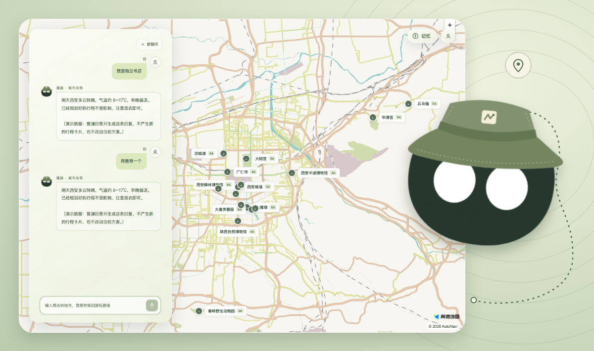
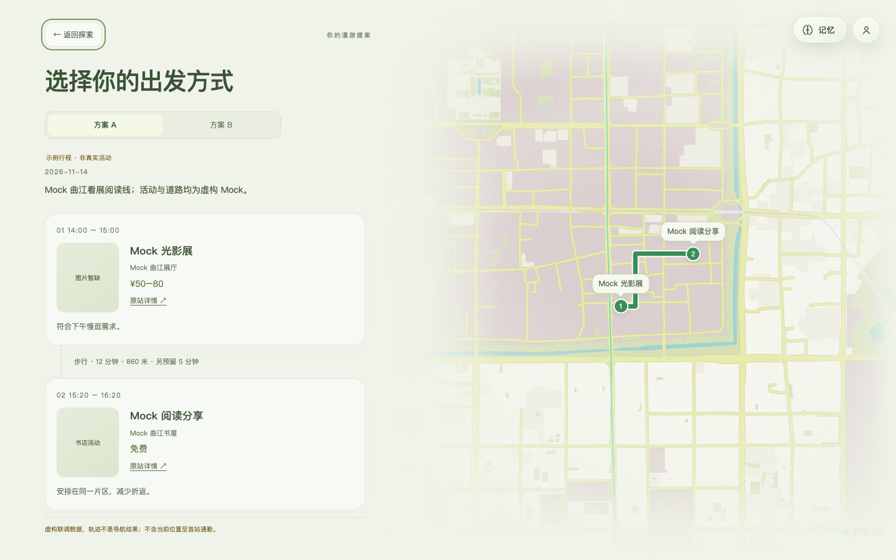
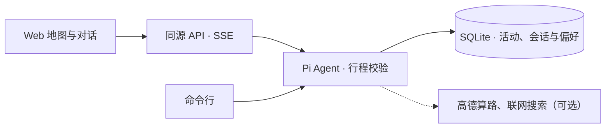

<h1 align="center">漫游 · 西安城市向导</h1>

<p align="center"><strong>在地图上发现西安，和 AI 一起安排半日游。</strong></p>

<p align="center">
  <a href="#快速开始"></a>
  <a href="#项目结构"></a>
  <a href="LICENSE"></a>
</p>

<p align="center">
  <a href="#快速开始">快速开始</a> ·
  <a href="#功能">功能</a> ·
  <a href="#项目结构">项目结构</a> ·
  <a href="docs/README.md">开发文档</a>
</p>

<p align="center">
  
</p>

在地图上选一个感兴趣的地方，或直接说「这周六下午想在西安看展、逛书店，别太赶」。漫游会查找当地活动，把建议排成时间线并标在地图上。想换一站，接着聊就行。

## 快速开始

需要 **Node.js 22.19+**。地图、地点搜索和实时天气需要网络。

```sh
git clone https://github.com/LiuMingyang-1/city-explorer-agent.git
cd city-explorer-agent
```

### 先看界面

```sh
npm run dev:frontend
```

打开 [A/B 行程演示](http://127.0.0.1:5173/?mock=comparison)，在对话框发送一条需求，即可用内置样例试用方案切换和地图路线。这个入口无需安装依赖、配置密钥或初始化数据库。

### 接入 AI

```sh
npm ci --ignore-scripts
cp -n .env.example .env
```

在项目根目录的 `.env` 中填入可调用的模型服务密钥 `EXPLORER_API_KEY`，然后使用仓库随附的西安活动库启动服务。

```sh
npm run dev:web
```

打开 [http://127.0.0.1:8080](http://127.0.0.1:8080)，点击右上角账号图标，用初次启动创建的账号登录。本地默认账号和密码均为 `admin`，可在首次启动前用 `EXPLORER_ADMIN_USER` 和 `EXPLORER_ADMIN_PASSWORD` 自定义。

如需试用从今天起 7 天内的模拟活动，可先在 `.env` 中设置 `EXPLORER_DB_PATH=data/demo-events.db`，再运行 `npm run seed` 和 `npm run dev:web`。每次 seed 都会替换目标库中的活动。随附的活动库是一个采集快照，近期活动随查询日期变化。

<details>
<summary>模型、地图与存储配置</summary>

| 配置项 | 用途 |
| --- | --- |
| `EXPLORER_API_KEY` | 模型密钥。按供应商回退到 `OPENAI_API_KEY` 或 `ANTHROPIC_API_KEY`。 |
| `EXPLORER_PROVIDER` / `EXPLORER_MODEL` / `EXPLORER_BASE_URL` | 选择模型服务。默认使用 OpenAI，切换 Anthropic 时设置 `EXPLORER_PROVIDER=anthropic`。自定义兼容端点需显式指定模型 ID。 |
| `EXPLORER_DB_PATH` / `EXPLORER_SESSION_DB_PATH` | 活动和会话分别存入 SQLite，默认路径为 `data/events.db` 和 `data/sessions.db`。 |
| `AMAP_JS_KEY` / `AMAP_SECURITY_JSCODE` | 可选，启用高德底图。默认使用 Leaflet 和 MapLibre。 |
| `EXPLORER_AMAP_KEY` / `EXPLORER_AMAP_TRANSIT_CITY` | 可选，启用高德站间算路。西安公交算路可将城市设为 `西安`。 |
| `EXPLORER_WEB_SEARCH_KEY` | 可选，启用 DeepSeek 联网搜索补充本地活动库。 |

完整配置及默认值见 [`.env.example`](.env.example)。

</details>

## 功能

| 功能 | 可以怎么用 |
| --- | --- |
| **地图探索** | 浏览西安景点和近期活动，点开活动卡查看时间、费用和来源，也可以把地点带入对话。 |
| **多轮规划** | 说出日期、可用时间和兴趣。Agent 检索活动库，生成经过时间窗校验的行程。继续说「第二站换一个」即可调整。 |
| **双方案对比** | 收到 A/B 方案时，在同一张地图上切换查看行程。配置高德算路后，可查看站间道路轨迹和预计通勤时间。 |
| **对话与偏好** | 恢复历史对话，查看和编辑长期偏好，让后续规划参考你的出行习惯。 |

<details>
<summary>查看 A/B 行程与地图联动截图</summary>



</details>

## 命令行

完成模型配置后，可以直接用随附的活动库在终端规划行程。

```sh
npm run dev
npm run dev -- "这周六下午在西安看展、逛书店"
```

交互模式支持多轮修改。脚本可用 `npm run --silent dev` 从 stdin 逐行输入，并从 stdout 读取逐行 JSON。提示、工具轨迹和错误输出到 stderr。

## 项目结构



| 路径 | 内容 |
| --- | --- |
| [`frontend/`](frontend/) | 地图、聊天界面与行程组件，直接由静态服务器托管。 |
| [`src/web/`](src/web/) · [`src/cli/`](src/cli/) | Web API、流式响应与命令行入口。 |
| [`src/agent/`](src/agent/) · [`src/itinerary/`](src/itinerary/) | 模型工具、规划会话与行程校验。 |
| [`src/collection/`](src/collection/) | 西安活动的独立采集与入库流程。 |

## 参与开发

欢迎在 [GitHub Issues](https://github.com/LiuMingyang-1/city-explorer-agent/issues) 报告问题或讨论改进。提交 PR 前可运行以下检查。环境和数据细节见 [开发指南](docs/development.md)，最初的参赛方案见 [产品规划](docs/planning/product-plan.md)。

```sh
npm run check
npm run check:frontend
```

## 许可

项目代码采用 [MIT 许可证](LICENSE)。随项目分发的第三方地图组件和头像组件各自的许可证见 [`frontend/assets/`](frontend/assets/)。
