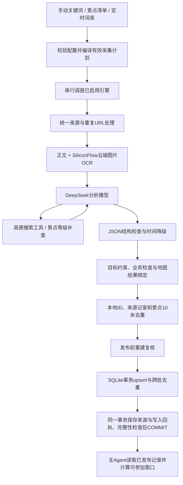

# 西安活动与景点数据采集系统

更新日期：2026-11-13。本文是采集模块自己的说明书，供负责数据采集、数据库和主 Agent 的同学共同使用。根目录原 README 仍保留；涉及本采集链路时，以本文和实际代码为准。本次高德补全在独立分支 `feat/amap-attraction-supplement` 实现，不合并主分支。

### 本次更新：高德优先与黄金数据复核

合并原有资料与高德补充后的实际缺项，见[黄金数据分类清单](../status/attraction-golden-classification-20261113.md)，逐条机器数据见[分类JSON](../status/attraction-golden-classification-20261113.json)。此前[高德覆盖清单](../status/amap-attraction-review-20261113.md)的237条并不是实际不合格总数：暂无评级、原有已填写等级、附加消费未知都不单独判失败。景点默认评级已统一为暂无评级，库内175条旧占位值已迁移，70条已有A级保留。本文后续历史实例和批次统计不代表最新覆盖率。

DeepSeek充值后的首批修复已执行，见[时间与现有资料修复报告](../status/attraction-time-repair-20261113.md)：58条高德时间逐条重处理，4条季节区间端点错误已修复。之后按用户最新Demo口径完成[补图与默认规则](../status/demo-attraction-completion-20261113.md)：18条景点补47张图片，245条都有图；53条空预算默认每人20元（2000分），已有0元免费和明确价格保留；百跃羊乳文化景区默认每天09:00–17:00。默认值明确标为项目估算，不宣称已获官方确认。

最后4条时间争议已按用户授权选用更可信的一套，见[时间选择结果](../status/attraction-time-resolutions-20261113.md)与[来源及依据](../data/attraction-time-resolutions-20261113.json)。目前complete=209、partial=36、conflicting=0；partial均有备注并按用户规则保留。三组同核心名称记录具体字段不同，全部保留；丝路欢乐世界也保留，城市明确为咸阳市。最新Demo口径检查未解决项为0，不把该结果解释为默认值、历史官网基准都已获现场实时确认。

部分时间只要time_note非空即可保留并交由主Agent结合备注规划，不独立判失败。15条高德附近定位已接受；4条原暂停、6条未确认正常开放及1条明确内部专用，共11条在time_note写不开放并设status=paused，实际检索排除。不要把“尚未确认开放”解释为已证实永久停业。

百度图片通过景点名检索并核对图像和原页面，排除错馆、AI配图和广告；一条学院博物馆另补馆方官网馆藏展示宣传图，标明不作为当前展期依据。记录[图片来源清单](../data/baidu-attraction-images-20261113.json)，只写image_urls/thumbnail_url，不替换guide_url。人工选择的图片证据存image_supplement；后续同POI空图片来源不会清空它，更高优先的同主体高德图片仍可覆盖。`scripts/audit-attraction-quality.ts`可只读重查剩余项，生成最新分类清单，不调用API、不改数据库。

`scripts/repair-attraction-times.ts`为该批次的缓存维护入口：默认预览，`--apply`在版本校验和相同task/write锁内写回data/events.db。已执行批次不能重复写入。它不发起API调用，使用本机私有规范化结果，入库前再次通过共享高德时间校验器；来源抓取时间不被重处理刷新，另存normalized_at。新采集同样禁止季节区间只列首尾日期、用weekly区间伪造节假日，允许由特殊时段推导常规时段的相邻边界。所有未确认的原文继续保留为time_note。

1. **同一个实体、同一个字段，高德优先。** 已选择并绑定的高德地点，其地址、场馆名、GCJ-02经纬度优先于正文、OCR和模型填写；模型不能自行制造高德证据。高德缺失某字段不等于其他来源错误，旧值保留并在复核清单标注依据不足。
2. **附近定位与馆内资料分开。** 用户已接受高德附近POI，允许用父校园、游客中心等作定位参考，不因缺独立POI拦截景点。保留景点名称，不把父地点照片、等级和营业时间直接套到馆内。
3. **A级、评分、费用各有含义。** business.keytag/atag明确标注的1A—5A用于category；business.rating是用户评分，不能转换为A级；cost是人均消费参考，不自动填为门票，避免把永兴坊人均消费误记为入场费。高德未给A级时保留已有等级，未知默认仍是“暂无评级”，清单注明尚未确认，不推断未评级或不适用。
4. **景点时间和活动时间分开。** 景点主体开放时间以高德为主；临时演出/展览的开始结束日期不会被场馆营业时间覆盖。简单且完整的每周表达本地规范，季节、节假日、分设施等复杂表达交给模型单独理解；对JSON结构、钟点、例外日期再校验。失败时保留高德原文、time_status=unknown，不生成假时间。名称明确“暂停开放”时status=paused，即使详情仍返回营业时间也不恢复active。
5. **图片与信息源分开。** 新采集优先使用所选高德POI的photos，链接仅允许高德/阿里云相关图片域名并升级HTTPS；无高德图片时回退来源附件。此次存量补全另外做了图片HTTP可用性检查，未通过的高德图片不写入。guide_url仍是原帖/网页信息源，不改成高德URL。
6. **未来更新不能倒退。** _collection_metadata.state.events[id].amap_authority保存受保护字段、核验时间及原始business/photos。相同POI、相同记录类型的后续弱来源不能覆盖已确认高德字段；新的高德结果优先，缺失字段沿用之前的高德值。POI或记录类型变化时不继承旧保护。时间元数据与events同步，不因保留了旧结束日期而把常设景点误判过期。这里只保证来源优先级，不承诺新数据自动达到全部黄金要求。

此次存量补全工具为 `scripts/supplement-amap.ts`，使用本机 `.local-data/xian/amap-supplement` 已下载的原始高德详情、时间规范结果及图片检查缓存，默认仅预览：

```powershell
node scripts/supplement-amap.ts
# 首次预览确认数据版本后，写回同一个数据库：
node scripts/supplement-amap.ts --apply
```

这是本次存量补全的缓存回放工具，不是新的联网采集入口。私有缓存不提交，其他机器须先准备相同结构的可信缓存；后续自动采集仍走原collect/collect:task入口。已写入的批次不能直接重复应用：脚本检查数据库SHA256、逐行原值、批次唯一性，并同时持有task/write锁。SQLite同一事务更新events、时间/来源元数据和before/after审计收据，任何一步失败回滚；20条活动和数据库永久ID不变。核验过程中若DeepSeek余额不足，未完成的复杂时间原文保留，并明确列入待核对，不能按成功规范计数。

黄金覆盖检查包括地点本体、可用图片、A级依据、公众参观条件、费用、简介、建议时长，以及未来14天可用的开放规则。A级未提供与真正地点冲突的严重程度不同，报告逐项列明，**报告不是删除清单，也不是全部记录已达黄金标准的声明**。估算时长可作为规划参考，原文依据与估算依据仍在provenance中区分。门票与简介沿用原来源的事实也会注明。

## 1. 任务、交付物与当前边界

我们的任务是为主 Agent 准备真实的西安市活动和景点数据。采集在本地离线批次中运行：搜索资料，理解正文和图片文字，确认高德地点，检查结构与业务约束，去重，再实际写入 SQLite 的 `events` 表。主 Agent 依托这些记录检索和规划，不负责替我们把搜索长文本导入数据库。

这里的“离线批次”指不在用户聊天请求中即时采集，实际搜索和模型分析仍需要联网调用服务。不是不用 API，也不是只输出 JSON。

| 能力 | 当前状态 | 说明 |
| --- | --- | --- |
| 手动统一采集 | 已实现并有真实历史测试 | `npm run collect`，引擎列表可配 |
| 小红书 | 已启用，最新测试需恢复登录 | MediaCrawler、正文和图片OCR；第二轮出现XHS_LOGIN_REQUIRED，不保证登录长期有效 |
| DeepSeek 网页搜索 | 已启用 | 返回来源文本，再由分析模型提取；不是搜索结果直接写表 |
| 模型调用高德工具定位 | 已实现 | 分析模型选地点，本地验证地点 ID 与坐标来自本次工具结果 |
| 景点 A 级补查 | 已实现 | 同一 DeepSeek Key；独立语义核验；无法确认用“暂无评级” |
| 活动/景点共表、时间备注降级 | 已实现 | 29个业务字段＋2个兼容列，共31列 |
| 唯一SQLite工作库、累计更新 | 已实现 | 固定data/events.db，events、来源元信息和写入回执在同一事务提交 |
| 景点10米去重 | 已实现 | 批次内和同一发布目录跨批次；活动不按坐标合并 |
| 247个景点初始清单 | 已实际处理全部目标 | 含西安交通大学创新港校区；原225个目标保留，22个复查后新增5个目标，仍有17个未保留 |
| 清单驱动采集 | 已完成真实批量构建 | 原始构建229条，复查新增5条；定时补充后当前库共245条景点、20条活动 |
| 日期关键词、区域/模板轮换 | 本轮已实现，离线测试通过 | 从词库编译成现有入口支持的有效配置 |
| 定时判断和 Windows 安装脚本 | 本轮已实现，离线测试及预览通过 | 默认关闭，尚未注册系统任务；未做无人值守在线验收 |
| 应用默认真实库 | 已初始化 | 已有229条景点已迁入data/events.db；本机该路径原先不存在，没有删除旧业务记录 |
| 其他社交平台 | 未启用 | 历史解析代码不代表当前可运行；知乎未接通，不宣称全平台覆盖 |
| 全库营业/结束状态自动维护 | 未完成 | 目前有时效过滤与发布能力，不等于完整刷新所有既有记录 |

清单入口已完成真实批量验证，原始结果见[初始景点构建报告](../status/initial-attractions-build-report-20261113.md)，后续见[前期修复报告](../status/initial-data-repair-report-20261113.md)。定时入口已做[两轮真实写入测试](../status/scheduled-two-rounds-report-20261113.md)：数据库写入成功，采集均为partial；Windows触发器没有安装。本文两条字段示例保留为历史样本；开放时间、价格和活动日期应结合来源与状态使用。

## 2. 文件入口与快速使用

所有命令在项目根目录执行，路径相对项目根目录解析。

| 文件 | 职责 |
| --- | --- |
| `configs/collection.example.json` | 现有手动采集配置 |
| `configs/collection.bootstrap.json` | 前期景点清单采集配置，可运行 |
| `configs/collection.scheduled.json` | 后续补充配置，可运行，定时开关默认 false |
| `configs/collection.keyword-library.json` | 18组68个搜索模板、地域、季节和节日窗口 |
| `configs/collection.scheduled.design.json` | 历史设计稿，不能传给运行入口 |
| `configs/xian-attraction-seeds.json` | 247个初始景点目标及名称线索 |
| `scripts/collect.ts` | 手动采集 CLI，默认仅预览 |
| `scripts/collect-task.ts` | 初始/补充任务 CLI，默认仅预览 |
| `scripts/collection-scheduled-task.ps1` | Windows 触发器预览、显式安装和隐藏执行 |
| `src/collection/task-plan.ts` | 配置校验、日期处理、轮换、有效采集配置编译 |
| `src/collection/task-runner.ts` | 任务状态、时间资格、互斥、每日防重复 |
| `src/collection/run.ts` | 两类入口共用的实际采集与发布实现 |
| `src/collection/extraction.ts` | 提示词、模型输出契约、事实检查 |
| `src/collection/analysis-model.ts` | 模型工具循环、高德搜索和等级核验 |
| `src/collection/time-policy.ts` | 无法规范的时间降级为备注 |
| `src/collection/preparation.ts` / `validate.ts` | 最终业务记录组装与发布前检查 |
| `src/collection/database.ts` | 唯一工作库初始化、原文件事务写入、元信息和回执 |
| `src/collection/releases.ts` | 共用的校验/去重更新逻辑；旧快照接口仅供兼容和历史测试 |
| `src/data/schema.ts` | 真实建表语句和幂等迁移，字段定义的代码依据 |

### 2.1 手动搜索小红书和网页

```powershell
# 默认预览：不读取密钥、不联网、不创建运行目录
npm run collect -- --config configs/collection.example.json

# 显式真实采集：会使用本地凭据、付费 API 和账号状态
npm run collect -- --config configs/collection.example.json --live
```

### 2.2 预览和执行一批初始景点

```powershell
npm run collect:task -- --config configs/collection.bootstrap.json
npm run collect:task -- --config configs/collection.bootstrap.json --manual --live
```

一次真实调用最多执行配置的一批目标，默认5个；成功完成后下一次调用继续下一批，不会一次启动247个目标。批次处理异常会保留进度；显式重新执行该未完成批次：

```powershell
npm run collect:task -- --config configs/collection.bootstrap.json --manual --retry-failed --live
```

`--retry-failed`重跑的是未完成批次，不是仅重发失败的一次 HTTP；本批已经成功的来源可能再次处理，调用也会重新计费。数据侧仍进行 ID upsert 和景点坐标去重。当前不声称已经实现每个 API 请求级的断点恢复。

### 2.3 预览和执行一轮补充

```powershell
# 固定日期只用于预览和调试，不能和 --live 同用
npm run collect:task -- --config configs/collection.scheduled.json --date 2026-11-13

# 手动明确运行一次，允许绕过 schedule.enabled=false 和运行时刻
npm run collect:task -- --config configs/collection.scheduled.json --manual --live

# 同一天明确再测试一轮，仍使用同一个数据库；不改变普通定时的每日限制
npm run collect:task -- --config configs/collection.scheduled.json --manual --force --live

# 定时器实际使用的形式：服从 enabled、北京时间和补跑窗口
npm run collect:task -- --config configs/collection.scheduled.json --live
```

Windows 安装脚本不加 `-Install` 只验证、预览。启用配置后，才可以显式安装；本轮没有执行安装命令。

```powershell
powershell.exe -NoProfile -File scripts/collection-scheduled-task.ps1 -Config configs/collection.scheduled.json

# 先把 schedule.enabled 改为 true，确认配置后才执行这一行
powershell.exe -NoProfile -File scripts/collection-scheduled-task.ps1 -Config configs/collection.scheduled.json -Install
```

脚本按当前 Windows 交互登录用户注册任务，不保存 Windows 密码，不提权。电脑关闭或该用户未登录时不能承诺运行；业务补跑窗口仍由程序判断。任务已存在时安装脚本拒绝覆盖。改变任务名称/心跳间隔需另行调整系统任务；只改业务关键词、引擎和业务时刻，下一次心跳会读新配置。

如果本机只有 `node` 而没有 `npm` 命令，等价形式是 `node scripts/collect.ts ...`、`node scripts/collect-task.ts ...`。Node 版本要求见 package.json（>=22.19.0）；本项目用 Node 直接运行可擦除类型的 TypeScript。

## 3. events 表的设计

### 3.1 为什么景点和活动共用一张表

主 Agent 最终需要的都是“在哪、可以什么时候去、待多久、花多少钱、依据是什么”。共表可以一次检索、统一地点与费用表示，通过 `record_type` 区分规则，不需要先查景点表再查活动表再拼接口。

- `activity`：临时展览、市集、演出、节庆等有项目或场次的对象。
- `attraction`：公园、博物馆、历史街区、校园游览主体、长期音乐喷泉等。
- 同一个公园与公园里的临时市集可以分别存在。地点相同不等于同一个业务对象。
- 景点的 `category` 是官方景区 A 级；活动的 `category` 是活动分类。两者通过 record_type 解释，不新增 tags。

### 3.2 全部31列逐项解释

“数据库允许 NULL”与“本采集器允许正式保留”不是同一层约束。兼容迁移允许某些旧记录缺值；新采集记录必须按发布规则检查，尤其是坐标。TEXT 没写显式 DEFAULT 时，SQLite 省略插入的默认值通常为 NULL，不表示采集器会接受缺失。

| 字段 | SQLite类型、空值/默认 | 具体意义、填写责任与注意事项 |
| --- | --- | --- |
| `id` | TEXT PRIMARY KEY | 本地生成 `xa_`＋32位十六进制身份；不能使用搜索排名/数组下标。SQL历史定义没另写NOT NULL，但采集检查明确拒绝空ID。 |
| `record_type` | TEXT NOT NULL，默认activity | activity/attraction。由模型理解具体主体；是其余分类和时间语义的分界。 |
| `title` | TEXT NOT NULL | 对象名称，不一定等于文章标题；可忠实概括，不要求是原文连续子串。 |
| `description` | TEXT NOT NULL | 面向规划的简介，说明游览内容、内部场所或访问限制；不能编造事实填满。 |
| `category` | TEXT NOT NULL，默认暂无评级 | 景点评级为1A—5A或暂无评级；缺失时脚本和SQLite均默认暂无评级。活动仍须显式填写固定12类之一，省略会被CHECK拒绝。不把4.6分换算为4A。暂无评级表示当前库没有可用等级，不等于确认官方未评级，也不单独判为不合格。 |
| `venue_name` | TEXT NOT NULL | 场馆、分馆或地点名称；内部中厅/展厅可在名称或简介保留。分店身份不能丢失。 |
| `address` | TEXT NOT NULL | 已选高德结果的地址，按程序加西安市、区县等。原帖文字与高德格式不同，采用确认地点的高德地址。 |
| `city` | TEXT NOT NULL，默认西安市 | 业务城市。搜索配置本身不保证全部命中来自西安，必须用地图结果确认。 |
| `amap_poi_id` | TEXT，可NULL | 高德地点ID。当前模型工具链的新记录必须绑定工具返回的POI；其他历史定位路径可能无POI。 |
| `latitude` | REAL，默认NULL | 纬度，GCJ-02。候选/旧表可空；本采集链路发布时必须是有效数字，和工具返回逐值一致。 |
| `longitude` | REAL，默认NULL | 经度，GCJ-02。与纬度成对；高德location为“经度,纬度”，组装时明确拆分，不颠倒。 |
| `valid_from` | TEXT，可NULL | 对象或活动有效期的开始日，YYYY-MM-DD，不是当天开门钟点。长期景点可以无开始日。 |
| `valid_to` | TEXT，可NULL | 有效期最后一天，含当日。活动展期结束日；不能把冬季营业规则的到期当作景点永久结束。 |
| `schedule_json` | TEXT，可NULL，须合法JSON | 开放/场次规则；SQLite存JSON字符串，业务JSON导出为对象。详细子结构见下节。 |
| `time_note` | TEXT，默认NULL | 时间原文、无法规范的节点、冲突和缺失说明。供理解和展示，不能直接当成机器排程窗口。 |
| `time_status` | TEXT NOT NULL，默认unknown | complete/partial/unknown/conflicting，表示时间信息质量，不等于活动营业状态。 |
| `suggested_duration_minutes` | INTEGER，默认NULL | 建议停留分钟，1—1440；可为空，可为带依据说明的估计。不是把活动总展期换成停留时长。 |
| `budget_min` | INTEGER，可NULL | 每人人民币预计最低费用，单位分。免费=0，未知=NULL；20元应写2000。 |
| `budget_max` | INTEGER，可NULL | 同一费用口径上界；非负整数，已知上下界时min<=max。 |
| `currency` | TEXT NOT NULL，默认CNY | 当前采集器只发布人民币。不能把其他货币金额当人民币直接写入。 |
| `budget_note` | TEXT，可NULL | 门票、可选付费项目、费用未知范围等说明。免费公园不代表游船/游乐设施免费。 |
| `guide_url` | TEXT，可NULL | **原信息源网址**。新采集记录直接复制帖子/网页URL；不是攻略专用，不改成高德或等级补查链接。历史NULL保留兼容。 |
| `thumbnail_url` | TEXT，可NULL | 优先取已选高德POI图片第一张，无高德图片时回退来源附件；只保存地址，没有图片则NULL。 |
| `image_urls` | TEXT NOT NULL，默认[] | SQLite里是JSON字符串数组；业务JSON里是数组。优先已选高德POI的photos，无高德照片时回退来源附件；来源合集图片仍可能不完全对应具体对象。本次存量补全额外校验高德图片HTTP可用性。 |
| `status` | TEXT NOT NULL，默认unknown | active/paused/cancelled/ended/unknown，对象是否有效；未知时间不等于paused或ended。 |
| `source_published_at` | TEXT，可NULL | 来源首次发布时间，UTC ISO时间点；不是活动开始时间。原站无可靠时间则NULL。 |
| `source_updated_at` | TEXT，可NULL | 来源编辑时间，与首次发布时间分开，不能单靠旧帖刚编辑就推断活动是今年。 |
| `fetched_at` | TEXT，可NULL | 本地抓取来源的时间点，新记录程序填写；不证明源事实是新事实。 |
| `updated_at` | TEXT，可NULL | 本地处理/组装记录的时间点；与来源编辑时间不同，也不等于官方最新更新时间。 |
| `start_at` | TEXT，默认NULL，兼容列 | 旧版单次窗口开始，北京时间YYYY-MM-DDTHH:mm。新模型不需要输出，主要使用valid_from和schedule_json。 |
| `end_at` | TEXT，默认NULL，兼容列 | 旧版单次窗口结束。不能用这两列把几十天展期描述成连续营业。暂留以兼容旧数据/调用方。 |

活动12类：展览、音乐现场、演出、市集、节庆活动、书店活动、讲座、工作坊、放映、景点参观、户外活动、体育赛事。“景点参观”是历史活动枚举，不表示长期公园必须归activity；长期主体优先归attraction。

景点分类：1A、2A、3A、4A、5A、暂无评级。这是官方景区A级，不是酒店星级、游客评价或模型喜好评分。模型可以补查A级，查不到不删除主体。

### 3.3 schedule_json 的内部结构

| 子字段 | 含义 |
| --- | --- |
| timezone | 固定Asia/Shanghai |
| mode | weekly每周规则；dates具体日期；always_open明确全天开放；unknown未知 |
| weekly[] | 每组包含weekdays和windows，可额外带该组季节有效期valid_from/valid_to |
| weekdays | 1周一到7周日，不能用0代表周日 |
| dates[] | date为YYYY-MM-DD，closed=true表示该日关闭；有开放时段时写windows |
| exceptions[] | 特殊日期覆盖普通规则；同结构，适合临时闭馆或特定日加开，不凭空枚举法定假日 |
| windows[].start/end | HH:mm，缺失可NULL；午休拆两个窗口 |
| end_day_offset | 默认0；跨午夜为1，例如22:00到次日01:00 |
| last_entry | 明确的停止入场钟点；规划的到达不能晚于该限制 |
| note | 该组时间规则的说明；不是可以执行的时间表达式 |

例如有依据的“周二至周日9:00—12:00、13:00—17:00，16:30停止入场”，应写两个窗口；不能合成9:00—17:00。这个例子只解释结构，不是对某个真实场馆的营业断言。

```json
{
  "timezone": "Asia/Shanghai",
  "mode": "weekly",
  "weekly": [{
    "weekdays": [2, 3, 4, 5, 6, 7],
    "windows": [
      {"start": "09:00", "end": "12:00"},
      {"start": "13:00", "end": "17:00", "last_entry": "16:30"}
    ]
  }]
}
```

`valid_from/valid_to`控制整个活动展期；季节开放时间的生效区间放在weekly项内。日期查询按规则计算当日 `availableWindows`，不会为整个展期先建几百条events。模型偶尔仍会枚举具体日期，当前契约允许并限制最大1000项；后续可优化输出体积，不应把空钟点的日期枚举误认为完整时间表。

### 3.4 时间可保留与可排程的差别

| time_status | 数据如何保留 | 主Agent应如何使用 |
| --- | --- | --- |
| complete | 有可计算窗口，仍需检查查询日、例外与有效期 | 按计算出的当日窗口排程，不能只看这个字符串 |
| partial | 部分日期/时段可靠，其余缺失 | 可检索；只有实际可解析的窗口才有资格用于精确安排 |
| unknown | 缺少可靠日期或钟点 | 可作为地点/活动线索展示，不能假设全天可去 |
| conflicting | 时间有未消除矛盾，冲突部分清空并备注 | 可展示冲突说明，不自动安排具体到访时间 |

发布读端的freshness判断对非complete采取保守处理：可发现，但allowPlanning=false。底层日期解析对partial也可能返回部分确定窗口；调用方应同时遵循读端/规划校验，不能只抓一段备注再自作主张安排。

## 4. 两条真实历史业务记录

以下两条从本地历史 `scenic-level-verified-20261113/combined-events.json` 按ID读取，展示29个业务字段，未重新生成内容；旧兼容列在业务导出中省略，其数据库值为NULL。两条均无图片，便于完整展示而不复制长串临时CDN地址。原始文件、API响应和数据库仍在忽略目录。

它们是当次处理结果，不代表所有语义已经由独立来源证实。曲江池的24小时说法来自当次游览页面，模型接受并不等于官方保证；锐锐专场的120分钟是建议停留，不是已确认的散场时刻。

### 4.1 曲江池遗址公园

```json
{
  "id": "xa_35c7865387b933d5c7327982efba732b",
  "title": "曲江池遗址公园",
  "description": "位于曲江核心板块的开放式唐文化遗址公园，以700亩湖面为中心，环湖分布仿唐亭台楼阁，可散步环湖、汉服拍照、怀古研学。园内有阅江楼、曲江流饮浮雕长廊、汉武泉鸣、中和广场、蘅芜洲石舫、烟波岛木栈道、明皇栈桥、曲江池历史博物馆等点位，西南侧相连寒窑遗址片区。园区免费开放、无需预约；游船、环湖观光电瓶车（约30元/人）为自费项目。景观灯光夏季19:30-22:00、冬季17:30-21:00，随季节微调。建议游玩2-4小时，推荐16点后入园。地铁4号线曲江池西站C口步行约8分钟至北门，8号线寒窑站B1口可达南岸。",
  "category": "暂无评级",
  "venue_name": "曲江池遗址公园",
  "address": "西安市雁塔区曲江池西路与曲江池北路交叉口东南角",
  "latitude": 34.20216,
  "longitude": 108.984261,
  "suggested_duration_minutes": 180,
  "record_type": "attraction",
  "city": "西安市",
  "amap_poi_id": "B001D0VQ3N",
  "valid_from": null,
  "valid_to": null,
  "time_note": "正文：24小时全年无休；景观灯光夏季19:30-22:00、冬季17:30-21:00，随季节微调。",
  "time_status": "complete",
  "schedule_json": {
    "timezone": "Asia/Shanghai",
    "mode": "always_open",
    "note": "正文称24小时全年无休、免费开放；景观灯光时段为季节性参考，非园区开放时间"
  },
  "status": "active",
  "source_published_at": "2026-09-10T16:00:00.000Z",
  "source_updated_at": null,
  "fetched_at": "2026-11-12T17:00:00.747Z",
  "updated_at": "2026-11-12T17:29:06.025Z",
  "budget_min": 0,
  "budget_max": 0,
  "currency": "CNY",
  "budget_note": "园区免费入园；游船、观光电瓶车（约30元/人）等自费项目另计",
  "guide_url": "https://tw.trip.com/moments/detail/xi-an-7-152355624/#1",
  "thumbnail_url": null,
  "image_urls": []
}
```

### 4.2 锐锐脱口秀专场《爱，来不来2.0》

```json
{
  "id": "xa_932bffe0dfac8be127c3f20381e01a21",
  "title": "锐锐脱口秀专场《爱，来不来2.0》",
  "description": "西安开元大剧院运营管理有限公司在开元大剧院举办锐锐脱口秀专场《爱，来不来2.0》，演员王锐等1人，许可编号610112512026000119。该信息来自未央区数据和行政审批服务局营业性演出准予许可决定公示，公示期2026年9月22日至11月21日。",
  "category": "演出",
  "venue_name": "开元大剧院",
  "address": "西安市未央区西安凤城九路与开元路十字西南角凤城九路34号",
  "latitude": 34.346468,
  "longitude": 108.952525,
  "suggested_duration_minutes": 120,
  "record_type": "activity",
  "city": "西安市",
  "amap_poi_id": "B0K2KSYHEV",
  "valid_from": "2026-11-21",
  "valid_to": "2026-11-21",
  "time_note": "原文仅载明演出时间为2026年11月21日，未提供具体钟点；公示期为2026年9月22日至11月21日，非演出时段。",
  "time_status": "partial",
  "schedule_json": {
    "timezone": "Asia/Shanghai",
    "mode": "dates",
    "dates": [
      {
        "date": "2026-11-21",
        "closed": false,
        "windows": [
          {
            "start": null,
            "end": null,
            "end_day_offset": 0,
            "last_entry": null
          }
        ]
      }
    ],
    "note": "资料仅给出演出日期2026年11月21日，未给出具体开演时间"
  },
  "status": "active",
  "source_published_at": "2026-09-22T16:00:00.000Z",
  "source_updated_at": null,
  "fetched_at": "2026-11-12T17:00:01.705Z",
  "updated_at": "2026-11-12T17:29:13.233Z",
  "budget_min": null,
  "budget_max": null,
  "currency": "CNY",
  "budget_note": null,
  "guide_url": "http://www.weiyang.gov.cn/zwgk/qzqd/spjgxx/2102312932801069057.html",
  "thumbnail_url": null,
  "image_urls": []
}
```

这两个例子说明：曲江池是长期景点，没有展期也可以保留；演出只有11月21日，不能把公示期当演出期，也不能补成19:30开演。演出费用未知，保留NULL；曲江池公园基础游览明确免费写0，游船另收费写备注。

## 5. 从脚本输入到SQLite的完整流程



### 5.1 输入与任务编译

手动入口读取有效配置，公共关键词可被某个引擎的keywords覆盖。不会擅自给输入加西安、日期等词。清单/定时入口先生成具体词，再复用同一套有效配置和采集运行器。

配置用Ajv或对应入口规则校验，未知字段拒绝，避免Key被误写进JSON。城市当前固定西安市；引擎必须已注册；所有启用引擎必须有关键词；引擎总limit必须至少给每个关键词分到1篇。不满足时在搜索前结束。

篇数按引擎所有关键词合计分配。当前定时配置两引擎各4词、limit=20，每词5篇；小红书适配器明确限制单词最多5篇、每轮最多20篇。不能把一个词配20篇替代4词各5篇。DeepSeek每轮上限20篇，本定时配置同样按4词各5篇执行。

### 5.2 搜索适配器与来源标准化

- 小红书：调用固定版本MediaCrawler的本地Python入口。搜索无头运行，使用隔离profile，单并发、最新排序，在详情处理前限制篇数；不采评论、子评论，不下载视频，不启代理。缺登录状态就失败，不自动弹出登录窗口继续任务。
- DeepSeek：本项目当前实现向固定搜索接口提交query/count/need_content=true；返回标题、原网址、正文或摘要、可用的发布时间。搜到网页不保证原站全文完整，也不自动保证官方可信。
- 两者转换为 `CollectedSource`：engine、keyword、title，以及document.url/text/published_at/updated_at/fetched_at/authority/content_scope/image_urls。
- 来源默认unverified。不是让模型说“官方”就自动升级信任；当前Demo默认也不强制每篇小红书都找到第二个官方来源才保留。

来源适配器不需要把events的所有列填出来。帖子标题、发表时间是资料字段，不是活动名和活动时间。没有正文的导出拒绝，不根据一个标题编内容。小红书视频目前只有文字说明和可用图片，未实现视频语音转录或逐帧OCR。

### 5.3 来源去重与失败隔离

普通补充批次按完全相同的来源URL去重，跨引擎命中同一URL只分析一次。当前没有自动删除所有追踪参数、没有跨网址语义正文去重，不宣称两个不同转载链接已经归并。

初始化时，同一官方名录可能覆盖多个清单目标；去重键改为“目标ID＋URL”。否则第一个目标处理过名录，会错误阻止第二个目标分析。帖子/网页不足预定数量时记录INSUFFICIENT_UNIQUE_RESULTS，不无限换关键词追数。

单个引擎失败不清空另一个引擎已得到的资料。所有来源都失败才整体failed；某个引擎缺数或有执行警告则partial。资料被正常判为“活动已结束”是业务拒绝，不等于搜索接口失败。

### 5.4 云端OCR

小红书图片由脚本从允许的CDN下载后，将图片字节提交给SiliconFlow托管的deepseek-ai/DeepSeek-OCR，再把结果和正文一起交给原分析模型。使用独立SILICONFLOW_API_KEY，不复用正文分析Key，不向CDN或OCR服务发送小红书Cookie。保留图片编号、逐图识别错误、耗时、尝试次数和服务商返回的token用量。每篇默认最多10张，当前定时配置ocr_max_images=20；每张最大12MiB。默认并发2张、模型单次60秒、单篇全部图片最多180秒；图片内容会发送给该云端服务，费用以服务商当前价格和账单为准。配置、错误分类及评估方法见[SiliconFlow OCR接入说明](../integrations/siliconflow-ocr.md)。

正文截取最多15000字符，OCR最多14000字符，总输入限制在30000字符内。OCR可能错字；图片文字和网页文字都被当作不可信资料，不允许其指令改变系统任务。

历史“蛋仔主题趣味派对”“捏捏闲置交换市集”的场馆在海报中。只读正文会缺场馆，OCR的作用是把这些事实补充给同一个分析模型，而不是由本地正则猜场馆。历史丰庆公园小红书资料有6张图，提取器从正文/OCR综合识别公园和同帖其他地点。

云端OCR只对网络、超时、429、5xx等暂时失败最多重试一次，成功图片不重复，图片编号保持不变；仍失败就保留错误，禁止手工补出图片文字后改写旧报告状态。认证失败、余额不足、非法图片域名、空响应、截断和明显重复输出等错误不重试；认证或余额错误停止同篇后续请求。超过配置图片上限或OCR执行失败会在报告中明确记下，整体运行可变为partial；不把“没识别后两张”说成“全帖已完整理解”。当前尚未按某张海报精准分配每条对象的展示图片。

### 5.5 DeepSeek语义分析与提示词

分析模型默认为deepseek-flash，使用DEEPSEEK_API_KEY。实际提示词以 `FACT_EXTRACTION_PROMPT` 为准，运行时同时提供当前UTC时间、Asia/Shanghai、来源首次/编辑时间、原URL、正文/OCR与输出schema。

模型负责判断：拆出哪些主体、是景点还是活动、分类、忠实标题和简介、展期与开放规则、费用口径、建议时长、对象状态、时间冲突。一个来源最多3个对象，不能把合集里A场馆的地址和B活动的日期拼起来。

提示词明确要求未知填NULL或默认枚举，不凭记忆补坐标、不把发帖时间当活动开场、不把旧帖编辑当今年依据、不用评分推断A级。描述和提取说明允许概括，不再要求引用必须是原文连续片段。

清单采集另传target（seed_id/name/aliases/area_hint），要求仅提取这个长期游览目标，并返回target_match和visitable布尔判断。不是目标、仅顺带提及、未开放在建项目、纯办公/宿舍不应保留。两个布尔值不是events表字段；程序检查显式true，但语义正确性仍依赖模型，不构成独立真实性证明。

### 5.6 模型使用高德工具

模型可以调用：

```json
{"name":"amap_search","arguments":{"keywords":"开元大剧院"}}
```

本地程序向高德v5地点搜索接口发送：keywords、region=610100、city_limit=true、page_size=10、page_num=1、show_fields=business,photos,navi，Key由程序注入，模型看不到Key。接口URL固定，不允许模型访问任意网络地址。返回GCJ-02坐标，同时保留business中的A级、营业时间、评分、人均消费及photos；这些字段由程序保留，不接受模型伪造高德来源。

工具输出place列表，每项是id/name/address/adcode/district/latitude/longitude。程序只保留西安行政码6101xx、城市名西安市、有效地址和合理坐标；location按经度、纬度拆分，直接使用GCJ-02，不转换WGS-84。

模型可以改词再查，理解简称、分店和商场内部场地。例如场地为“商场一层中厅”，可选确认所属商场的POI，并在简介注明定位到商场；不能用同品牌另一分店替代。选择后模型原样返回POI ID与经纬度。

本地为每份文档维护本次工具结果登记表。只接受这个文档实际查出的ID与完全一致的坐标，最终地址从登记表取值，忽略模型另写的地址。**本地证明的是“返回值来自哪条地图结果”，具体地点是否就是帖子所指仍主要由模型理解。**高德证明地点与城市，不证明临时活动正在举办。

历史鸟剑高新万达店曾发生App有地点、Web接口未返回可用POI。失败表示当前程序没拿到可绑定坐标，不能推断店不存在，也不应拿其他分店坐标填入。历史机械地址比对的旧失败码见后文；当前统一入口已改为模型工具选点。

### 5.7 景点等级补查

仅景点可调用search_scenic_level。工具用同一个DeepSeek Key按正式场馆名搜索官方A级材料，每次最多3份结果、每份最多6000字符。模型提出等级后，程序检查材料确有对应A级写法，再用相同模型做专门语义核验，确认是该具体对象、官方有效等级，不是父景区/拟评定/撤销或游客评分。

查不到、请求失败、预算用尽、材料不支持都回退“暂无评级”，不会为这个原因删除景点。补查只用于等级，不覆盖原帖的票价、时间和信息源URL。

真实回放中，大明宫5A、大唐西市4A、幸福林带3A得到确认；曲江池属于组合景区的材料没有被直接赋成公园自己的5A。这些是历史API材料和模型核验结果，不是我们另行颁发等级。

### 5.8 时间标准化与备注降级

先标准化能够明确解释的日期/时区。新版主要用有效日期＋开放规则；遗留带秒/时区的单次时刻可转换为北京时间分钟。

时间问题优先清空不能使用的字段并记time_note，而不是整条丢弃：非法日期、结束早于开始、把多天展期塞成连续窗口、非法开放规则、实际日期/时段冲突。发现冲突不擅自挑一边；仍可保留名称、简介、地图和费用等可靠字段。

不猜开门/散场，不把没有时间的地点设为always_open。缺结束日期、旧文章、活动开始超过默认14天都不再单独触发整条拒绝。14天仍是数据包的默认任务跨度信息，不是“只能存未来14天”的SQL约束。

锐锐专场是完整例子：有效日期2026-11-21，window.start/end都NULL，time_status=partial，备注说明未提供钟点。可以入库、用于检索，不够安排19:00—21:00行程。

### 5.9 非时间业务检查与模型结果绑定

结构必须符合schema：类别枚举、字符串非空、金额是非负整数分、建议时长是1—1440或NULL。状态明确past/paused/cancelled的新候选不作为当前可用对象保留。

时间降级后再检查仍存在的具体窗口、建议时长与固定演出的一致性、确认结束日期是否已过、采集时钟是否可信。发布活动的抓取新鲜度36小时，景点30天；这检查的是采集/核验链路，不会因为源文章发表于几个月前就自动拒绝长期景点。

地图返回本身无效、未绑定，或不在西安，不能继续作为正式events。等级/时间可降级，但不靠猜坐标保留。模型返回JSON并不代表有写库权限。

### 5.10 ID、来源记录与入库前去重

本地来源项目key由原URL＋标准化标题哈希生成，场馆key优先用amap:POI_ID；slot注册表保存已确定的时段身份。最终ID是来源项目key、场馆key、slot_key的哈希，结束时间/费用调整不直接重算原slot身份。新规则记录常为unscheduled兼容身份。

当前不能宣称跨不同来源已实现活动语义去重：同一活动被两篇不同文章报道，来源项目key可能不同。景点随后有坐标去重弥补一部分；活动不能只按同地址删除。

景点默认GCJ-02地面距离<=10米算重复，用球面距离计算，不直接比较固定经纬度小数差。优先保留时间和字段更完整、状态可用、来源较新的整条记录，不把多个来源的字段任意拼接。距离链A-B-C不使超过阈值的A-C自动合并。

合并关系记录removed_id/kept_id/distance_meters/source_urls。父景点和子场馆如果坐标恰相同，也可能被该Demo规则合并；这属于规则的已知取舍。当前按完整度换代表记录可能改变跨来源景点ID，正式长期引用前应补稳定主体ID策略，不应承诺既有行程永不丢引用。

### 5.11 最终数据包检查

内部数据包为schema_version=xian-events/4，包含base_date、days=14、events和provenance。事件列表不是裸模型JSON：ID、来源、坐标证据、费用单位等已经完成程序组装。

validateDataset再次检查字段、ID、来源关联、来源正文SHA-256、URL、坐标系、粗范围、重复ID/时段、金额、核验时间等。正文hash用于保证核验输入没被换掉，不要求模型说明逐字出现在正文。

当前最终批次provenance.verified_at统一要求距发布不超过36小时，即使景点原文抓取可在30天内；这是“现在完成本次组装核验”和“原资料何时抓取”的区别。不能直接把一个月前的prepared对象拿来当今天刚处理的批次发布。

### 5.12 写入唯一SQLite工作库

生产配置统一使用database_path=data/events.db。每轮、每份资料都更新这个文件，不在run目录或releases目录创建新数据库，不切换CURRENT。

本分支交付包含真实工作库data/events.db（265条：245景点、20活动）及data/events.manifest.json校验清单。克隆此分支后可直接读取该库；后续采集仍原地更新，Git会显示数据库变化，清单校验和只对应本次提交时的版本。其他数据库、SQLite临时文件、.env、Cookie及.local-data缓存仍排除在Git之外。交付范围与验证结果见[分支交付说明](../status/collection-branch-delivery.md)。

1. 首次启动从已有真实发布库迁入229条景点及对应来源信息；以后发现已初始化标记就直接读工作库，不重复覆盖。
2. 发布前根据私有witness重建并比对记录，沿用原地图、事实和来源校验。
3. 获取data/events.db.collection-write.lock，打开同一个文件，BEGIN IMMEDIATE。
4. 在events按ID执行INSERT ... ON CONFLICT DO UPDATE，不清空表。景点与已有记录做10米去重；不同活动不按坐标合并。
5. 在同一SQLite事务内更新_collection_metadata中的来源、身份注册表、时效和去重审计；保存本份资料的batch回执。
6. 检查业务ID与来源对应、PRAGMA integrity_check，通过后COMMIT；任一环节失败同时回滚events和元信息。
7. run目录只保存JSON诊断、write-N.json和统计，不生成新的events.db。database_id保持不变，路径也保持不变。

旧快照是历史只读备份，不是另一个工作库。publish_root在当前配置中仅用于首次读取既有真实库；初始化完成后不再向该目录发布。

### 5.13 历史时间纠错与前期复查

后续采集提示词明确区分停止售票与停止入场，禁止把周几闭馆/节日名称展开成示例日期写入exceptions，子场馆不自动继承父景区或校园时间。无法规范的原文仍保留time_note，不靠补造时间获得complete。

已入库旧资料通过缓存来源审计修正：只允许删已有例外、清已有last_entry、清空无依据规则或降低时间确定性；不能填新时刻或坐标。命令先预览，显式--apply才写入；逐项比较被审计版本，修改过的记录拒绝覆盖。事件、元信息和包含before/after的batch回执同事务更新，复用唯一数据库任务锁，不刷新原资料的fetched_at或lastVerifiedAt。本次19条修正保留原ID、坐标和来源；2条无子馆独立时间的规则改unknown，原文备注仍可读。

```powershell
# 预览已有私有审计manifest；已应用批次不能重复执行
node scripts/collection-correct-times.ts .local-data/xian/planning/initial-time-corrections.json
```

22个前期未入库目标的复查使用configs/collection.bootstrap-recheck.json，对应configs/xian-attraction-recheck-seeds.json；其独立进度在.local-data/xian/bootstrap-recheck/state.json，不重置原247目标进度。每目标2篇DeepSeek资料、5目标一批，同样通过模型/高德/校验/去重写data/events.db。该复查已执行完成，5个目标恢复、17个仍舍弃；再次执行已完成任务不会无限重采。这是一次历史质量修复，不是每天定时任务必须人工介入的步骤。

## 6. 校验不通过、降级与执行异常一览

应区分三件事：对象不保留、字段降级但对象保留、接口/执行不完整。下面给出当前常见代码及文字意义；不要只把字母码给用户。

### 6.1 来源、模型结构及业务拒绝

| 代码/情形 | 具体解释与处理 |
| --- | --- |
| INVALID_COLLECTION_RUN_CONFIG / INVALID_TASK_CONFIG | 配置未知字段、类型、枚举或必需内容不合法；搜索前失败，不是活动真假判断。 |
| COLLECTION_ENGINE_LIMIT_EXCEEDED / COLLECTION_LIMIT_BELOW_KEYWORD_COUNT | 超过适配器上限，或总篇数少于关键词数，无法分配最少1篇。 |
| MISSING_EXPORTED_TEXT | 平台导出缺正文，只见标题；不让模型补造全文。 |
| INVALID_JSON_LINE / INVALID_EXPORT_ROW / INVALID_SOURCE_ID | 上游导出不能解析、结构或内容ID不合法，拒绝该来源行。 |
| COMMENTS_NOT_SUPPORTED | 导入拿到评论而不是目标帖子，不作为活动正文。 |
| INVALID_CACHED_EXPORT / INVALID_OR_DISABLED_SOURCE_DOCUMENT | 缓存结构、平台、来源URL或正文hash不符合当前入口要求。 |
| INVALID_DOCUMENT | 正文空、过长或来源URL不合法，不能交给当前提取器。 |
| MODEL_REQUIRED | 输入没有直接可用的结构化事实且没有提供模型，不是正则能完成的步骤。 |
| INVALID_EXTRACTION_SCHEMA / INVALID_FACTS_SCHEMA / SCHEMA_INVALID | 模型JSON无法解析或字段不合约；有限结构重试后仍失败。具体应查看字段路径。 |
| BLANK_FIELD / BLANK_FIELD:字段 | 标题、简介、场馆等必需信息为空白，不是NULL未知时间的情况。 |
| CATEGORY_RECORD_TYPE_MISMATCH | 景点填成展览，或活动填成5A等枚举组合错误。 |
| TARGET_RECORD_TYPE_MISMATCH | 初始化只采景点，却返回了临时活动。 |
| TARGET_NOT_CONFIRMED | 清单任务中模型没有显式确认该对象就是指定目标；不能用另一所学校或附近公园顶替。 |
| TARGET_NOT_VISITABLE | 未确认具有游览用途；不以办公、宿舍、未开放在建主体填充景点库。 |
| NOT_ACTIVE | 模型/补充逻辑确认past、paused或cancelled；新候选不纳入当前可用记录。 |
| ALREADY_ENDED | 确认的结束日期/结束时刻，或全部具体日期场次已过去。不是只因游客说“去过”。 |
| INVALID_CLOCK / INVALID_PUBLICATION_TIME / INVALID_FETCH_TIME | 核验/抓取/发布时间格式无效或出现不允许的未来时间，需要检查来源转换和本机时钟。 |
| SOURCE_FETCH_STALE | 活动抓取超过36小时或景点超过30天；不能把陈旧缓存当新采集。 |
| INVALID_BUDGET_RANGE | 最低费用高于最高费用；schema也会拒绝负数、小数“分”。 |
| DURATION_EXCEEDS_WINDOW | 已确认的单次窗口短于建议停留，例如窗口60分钟却建议120分钟。 |
| FIXED_DURATION_CONFLICT / FIXED_DURATION_UNCONFIRMED | 旧式固定演出完整窗口与时长冲突，或固定时长的来源依据不足；不会靠估算散场修正。 |
| INVALID_SOURCE_URL / INVALID_PUBLIC_URL | 网址不是可接受公开HTTP(S)，含账号密码、敏感query参数或本地/测试/IP地址等。 |
| SYNTHETIC_CONTENT | 关键文本出现“模拟数据”“虚构活动”等明确合成数据标记，或独立mock/fixture/synthetic词。普通“模拟飞行”不拦截；这是粗检查，不是完整真假分类器。 |

### 6.2 地图、城市与坐标

| 代码/情形 | 具体解释与处理 |
| --- | --- |
| MODEL_LOCATION_NOT_BOUND | 最终对象没有选中本篇工具结果的POI，或ID/经纬度不一致。不能发布；不等于地点不存在。 |
| LOCATION_NOT_VERIFIED_OR_NOT_BOUND | 最终组装时发现定位与请求对象、城市、坐标系、核验时间或原始坐标不一致。 |
| CITY_NOT_CONFIRMED / COORDINATE_OUTSIDE_COARSE_REGION | 无法确认西安归属，或坐标明显越出粗范围。粗范围不是精确市界，工具还要求6101xx和西安市。 |
| COORDINATES_MUST_BE_PAIRED | 只填经度/纬度之一；候选应两者都空或两者都有。 |
| COORDINATE_SYSTEM_MISMATCH | 出现WGS-84输入/转换标记，与当前GCJ-02契约冲突。 |
| MAP_API_REJECTED | 高德返回业务失败status，并非程序判定“地址错误”。可能涉及Key、权限或服务端限制；看本地map_attempts的infocode，不猜具体原因。 |
| MAP_RATE_LIMITED | 高德10021限流，有限重试后仍被限。无法完成定位，不证明候选不存在。 |
| MAP_HTTP_ERROR / MAP_EMPTY_RESPONSE / MAP_RESPONSE_TOO_LARGE | HTTP或返回体异常，属于定位执行问题。 |
| MAP_BUDGET_EXHAUSTED / INVALID_MAP_KEYWORDS | 达到本轮地图请求预算，或查询词空/过长；需要调整任务，而不是填猜测坐标。 |

地图工具错误会作为tool结果返回模型，模型可改词/换查法；最后仍没有绑定地点时，外层常只看到MODEL_LOCATION_NOT_BOUND。排查时应连看本地map/API诊断，不能把外层一句“未绑定”当成唯一根因。map_attempts记录业务code；HTTP异常目前部分code仍较粗，不保证都能自动细分。

旧的无工具geocoder路径还保留AMBIGUOUS_POI（多个候选不能唯一选）、BRANCH_NOT_CONFIRMED（品牌有结果但目标分店未确认）、NO_EXACT_POI_MATCH（本地名称规则未确认）、POI_GEOCODE_CONFLICT（POI和地址解析冲突）、PRECISE_ADDRESS_REQUIRED（退回地址解析还缺门牌）、ENTRANCE_NOT_CONFIRMED（需要入口但没确认）等。它们用于历史回放/兼容路径，当前统一模型工具入口不再先用字符串地址相等来决定POI。

### 6.3 时间问题：当前优先降级，不直接丢主体

| 情形/检查码 | 当前处理 |
| --- | --- |
| 非法日期、INVALID_VALIDITY_DATE / INVALID_START_DATE / INVALID_END_DATE / INVALID_DATE_RANGE | 正常提取路径先清理不能规范或前后矛盾的日期，原文/问题入time_note。绕过降级直接传最终数据仍被拒绝。 |
| INVALID_SLOT | 旧单窗口格式错、结束不晚于开始或超过24小时；提取路径清空旧窗口并备注，不把展期当连续营业。 |
| INVALID_SCHEDULE_DATE / INVALID_SCHEDULE_CLOCK / INVALID_SCHEDULE_WINDOW | 重复/非法日期、25:00、非跨夜却结束早于开始等；坏规则清空，保留解释。 |
| INVALID_LAST_ENTRY / CLOSED_WITH_WINDOWS | 停止入场不在窗口内，或同日同时关闭和开放；坏规则降级。 |
| 冲突时间 | 设conflicting，清空受冲突影响的规则/时刻，日期冲突时连相关有效日期也清空。 |
| 只有11.29、没有可确认年份 | 不无条件当今年；不能确定则留备注。近期首次发布时间可以提供上下文，单靠编辑时间不行。 |
| 缺钟点、缺结束日期、旧来源但主体可用 | 可保留partial/unknown；不默认补午夜，也不单独因此拒绝整条。 |
| 活动开始超过未来14天 | 不再是拒绝条件；仍需其他事实合法。 |

不再使用的旧硬限制包括“引用不是正文连续片段”“来源非官方就必须拒绝”“所有时间必须完整”“conflicts数组非空一律丢弃”。不应拿旧验收里的拒绝结果直接当当前程序行为。

### 6.4 来源追踪、重复和发布失败

| 代码/情形 | 具体解释 |
| --- | --- |
| MISSING_PROVENANCE / DUPLICATE_PROVENANCE / ORPHAN_PROVENANCE | 业务记录与来源追踪缺失、重复或不对应；拒绝发布。 |
| EVIDENCE_NOT_FOUND / CITY_EVIDENCE_NOT_FOUND | 引用资料的URL/hash找不到对应核验输入；不是要求描述逐字匹配。 |
| SOURCE_URL_MISMATCH | guide_url与该记录原source_url不一致，不允许用等级补查链接冒充原帖子来源。 |
| UNSTABLE_ID / DUPLICATE_EVENT_ID / DUPLICATE_SLOT | 身份哈希不一致、ID/场次重复；不能重复插入或覆盖为另一主体。 |
| AMBIGUOUS_OCCURRENCE_IDENTITY | 同项目已有多场但新资料缺场次信息，无法安全选择一个旧身份。 |
| DUPLICATE_ACTIVITY_IN_BATCH | 同一批组装出相同ID，重复项不再插入。 |
| ATTRACTION_COORDINATE_DUPLICATE | 景点落在10米阈值内，按规则合并；属于去重，不是数据无效。 |
| DURATION_BASIS_MISMATCH | 建议时长有无与“未知/来源/估计”的内部依据不一致。 |
| INVALID_VERIFICATION_TIME / INVALID_BASE_DATE / INVALID_AS_OF | 批次核验时间、基准日期不合法或过期，不能伪造刚处理。 |
| POSSIBLE_SECRET | 数据包出现疑似密钥形态，阻止发布；不是完整泄漏检测保证。 |
| PUBLICATION_WITNESS_REQUIRED / PUBLICATION_WITNESS_MISMATCH | 缺原始核验输入，或重建结果与拟发布记录不一致。 |
| COLLECTION_DATABASE_LOCKED / TASK_LOCKED | 同一工作库已有写入/任务，避免两个profile同时写同一文件。 |
| DATABASE_INTEGRITY_FAILED / COLLECTION_DATABASE_METADATA_OUT_OF_SYNC | SQLite完整性或业务/来源对应不通过，事务回滚。旧快照迁移时仍检查原manifest与hash。 |
| CANCELLED_EVENT_REQUIRES_EXPLICIT_CORRECTION | 已有取消标记，不能用普通旧资料重新激活。 |
| UNCHANGED_SOURCE_NEEDS_REVERIFICATION | 原资料未变化且旧核验已失效，不能仅重复抓取自动刷新有效性。当前该保护依赖有title证据hash，非所有资料都能获得同样保护。 |
| NO_ELIGIBLE_UPDATES | 本批全部被发布规则挡住/没有可写变更；保留旧版本，不假报新增。 |

代码中还保留可选官方补证路径PRIMARY_SOURCE_REQUIRED/NOT_FOUND/CONFLICT_OR_AMBIGUITY，分别表示调用方要求补证、没找到、补证主体冲突/不唯一。当前统一入口默认不启用requirePrimary，不能将它描述为所有小红书的必经步骤。

### 6.5 接口异常与任务状态

| 代码/状态 | 解释 |
| --- | --- |
| AUTH_FAILED / INSUFFICIENT_BALANCE / RATE_LIMITED | DeepSeek鉴权、余额或限流问题，不是活动字段错误。鉴权/余额失败后同客户端停止新HTTP，并停止后续文档处理；充值恢复后明确继续未完成批次。 |
| TIMEOUT / NETWORK_ERROR / HTTP_状态码 | 请求没有按期完成或HTTP失败；有限结构调用不等于无限重试。 |
| EXTRACTION_BUDGET_EXHAUSTED / SEARCH_BUDGET_EXHAUSTED / ANALYSIS_*_BUDGET_EXHAUSTED | 达到HTTP或工具轮次预算；不能绕过预算继续搜。 |
| XHS_LOGIN_REQUIRED / XHS_TIMEOUT / XHS_SEARCH_FAILED / XHS_EXPORT_MISSING | 小红书登录失效、超时、搜索执行或导出失败；看coverage和本地诊断，不把零结果当成功。 |
| OCR_IMAGE_LIMIT / OCR_FAILED / OCR_TIMEOUT | 只处理部分图片或OCR执行失败，记录partial，不等于已经证明无活动。 |
| RUN_DEADLINE_REACHED | 到本轮软时限，不再启动新查询/文档；在途有界请求完成后释放锁。 |
| ALREADY_ATTEMPTED_SCHEDULED_DAY | 同profile同计划日期已执行过；正常定时不重复，只有明确--manual --force可再运行。 |
| OUTSIDE_SCHEDULE_WINDOW / SCHEDULE_DISABLED | 没到时间/超过补跑窗口，或开关关闭；没有执行搜索。 |
| USE_RETRY_FAILED_FOR_BOOTSTRAP | 初始上一批未完成，需明确重试；不是要求人工逐条核验内容。 |
| BOOTSTRAP_EXHAUSTED | 清单目标已全部尝试完成，成功返回，不继续查询。 |

正常候选拒绝仍可能让整个采集任务status=success，因为执行本身完整；这不代表“每条都合格”。`task_completed`表示本批无执行缺口、可推进游标；允许空结果或全候选业务拒绝完成该词。不要用success替代有效新增数量。

### 6.6 四个真实历史案例

1. **曲江池历史博物馆**：当次模型没有确认到高德地点，ID/坐标为空，未保留。含义是定位未完成，不证明馆不存在。当前仍需真正返回可绑定POI才可入库。
2. **“秋日拾趣，好物相逢”野趣跳蚤集**：报道明确“欢乐收官”，模型判past；按NOT_ACTIVE拒绝，不继续当未来市集。
3. **大明宫国家遗址公园**：时间有矛盾，历史批次保留主体并设conflicting，不能把冲突时间排进主Agent行程；等级补查仍可独立确认5A。
4. **丰庆公园**：小红书明确免费，但没给开放钟点；保留暂无评级、time_status=unknown、schedule=NULL、0分基础游览预算和高德坐标。时间/评级不完整没有导致整条丢弃。

## 7. 数据库、发布目录与主Agent对接

### 7.1 唯一文件中的业务表和内部信息

唯一工作数据库是data/events.db。初始化、手动采集和定时补充的正式配置都指向这个文件，应用默认也读取此路径。历史.local-data快照保留为过去实验的只读备份，不参与日常写入。

| 表/文件 | 意义 |
| --- | --- |
| events | 31列业务表，29个业务字段和2个旧兼容时间列，字段含义不变 |
| _collection_metadata | 同一数据库中的内部key/value表，来源与事务回执，不增加新的业务数据库 |
| .local-data中的state.json和run日志 | 任务轮换、执行记录和诊断，不是景点数据库 |

_collection_metadata两个字段：key为TEXT NOT NULL PRIMARY KEY；value为合法JSON的TEXT NOT NULL。主要键如下：

- database_id：数据库创建时生成的永久身份；每轮都应相同。
- state：来源provenance、firstSeenAt/lastVerifiedAt、身份注册表、去重关系、取消标记等。
- initialization：首次迁入来源、初始记录数及时间。
- batch:<批次ID>：本份写入的回执，包含数据库路径/ID、写入前后条数、实际写入数和舍弃原因。

这些元信息和events在同一SQLite事务中提交，避免“数据库已写、旁路JSON还没更新”的中断不一致。原始全文、图片OCR和API响应继续保留在私有run目录，Key和Cookie不进入数据库。

数据库写入锁为data/events.db.collection-write.lock，任务锁为data/events.db.task.lock。锁随工作库路径绑定，因此不同profile或output_dir也不能并发写同一文件。SQLite的短暂journal是事务机制，不是另一份工作数据库。

### 7.2 数据库约束和迁移

- SQL约束非空主体字段、类型对应分类、坐标成对和范围、时长1—1440、金额非负/上下界、状态枚举、JSON合法性。
- JSON字符串语法合法不等于开放规则语义合法；后者由应用parseSchedule检查。
- 新库一次建齐；旧库按需补列。解除旧NOT NULL/旧CHECK时用事务重建，保留行、自定义列、显式索引/触发器，并检查外键；失败回滚。
- 旧记录类别不属于当前词表时迁移停止，不静默改成另一个类别。
- 当前基础DDL没有额外建立全文索引或RTree。Demo数据量以现有查询为主，后续确有性能瓶颈再添加按类型/城市/POI等索引，不将“建议索引”写成已实现。
- 数据库没有每行coordinate_system列，当前新采集契约整体为GCJ-02，来源sidecar保存系统标记。不能把旧WGS-84数值改标签混入。

### 7.3 主Agent拿到哪些信息

主Agent仍可通过search_events查询，recordType可选activity/attraction；数据库字段转为业务对象的camelCase。guide_url映射guideUrl，语义仍是来源链接。schedule_json映射schedule，image_urls解析为数组。

日期查询根据validFrom/validTo、每周/日期规则与例外计算availableWindows和availability(open/closed/unknown)，先过滤再限制条数。getByIds和行程校验应按实际行程日期重新算窗口；到访必须完整落在同一可用窗口内，不跨午休，不晚于停止入场。建议时长为NULL时，主Agent不能把它当官方确认的固定演出时长。

GCJ-02附近参考点、路线与地图底图也必须统一；目前没有一并替换所有前端旧底图和浏览器定位流程，不宣称地图显示端已完成统一。

### 7.4 首次迁移和应用读取

本机原先没有data/events.db，当前已经从已校验的229条真实景点库迁入该路径，保留原ID、31列字段和来源信息。以后每次采集直接更新此库，重复初始化不会把新增数据覆盖回229条。

应用默认EXPLORER_DB_PATH=data/events.db；自定义应用配置时也应指向这唯一工作库。不能再把旧initial-build/events.db快照当成持续更新的数据库。不要运行会重置events的模拟seed脚本。

对于已有未知数据而没有采集元信息的目标库，程序返回EXISTING_DATABASE_REQUIRES_EXPLICIT_MIGRATION，不自动清掉假数据或其他业务表。需要明确的备份、识别与迁移流程；不改sessions。

## 8. 配置文件：目前具体怎么填

### 8.1 手动有效配置

```json
{
  "city": "西安市",
  "keywords": [
    "西交创新港"
  ],
  "engines": [
    {
      "name": "xiaohongshu",
      "enabled": true,
      "limit": 5
    },
    {
      "name": "deepseek",
      "enabled": true,
      "limit": 5
    }
  ],
  "output_dir": ".local-data/xian/unified-runs",
  "processing": {
    "enabled": true,
    "ocr": true,
    "attraction_duplicate_meters": 10
  },
  "budgets": {
    "model_requests": 80,
    "map_requests": 60,
    "level_searches": 10
  },
  "database_path": "data/events.db",
  "publish_root": ".local-data/xian/real-release"
}
```

| 参数 | 作用与限制 |
| --- | --- |
| city | 默认西安市，目前只支持该城市 |
| keywords | 公共具体搜索词，最多10个，每词1—100字符且不能纯空白；不解析模板变量 |
| engines | 引擎列表；name必需；enabled默认true；limit默认5 |
| engines[].keywords | 可覆盖公共词；limit是本引擎全部词的总来源配额 |
| output_dir | 本次运行目录的父目录，必须在.local-data内部 |
| database_path | 唯一工作库，默认data/events.db；正式配置统一此路径，私有.db路径只用于隔离测试 |
| publish_root | 首次迁移的旧真实发布根，仅在工作库未初始化时读取CURRENT；以后不写该目录 |
| base_date | 可选YYYY-MM-DD，默认北京时间当天；不是搜索服务的发布时间过滤 |
| processing.enabled | 是否正文分析、地图与发布；false只采来源 |
| processing.ocr | 默认true；false不识别图片 |
| processing.ocr_max_images | 每篇最多识别图片数，默认10；定时配置20，上限20；这不是帖子篇数 |
| processing.attraction_duplicate_meters | 默认10米，可0—100；仅景点，非活动 |
| budgets.model_requests | 默认80，主分析HTTP请求上限，不是“最多80条活动” |
| budgets.map_requests | 默认60，地图HTTP请求上限，含限流重试 |
| budgets.level_searches | 默认10；景点等级搜索和专门等级核验各有独立上限，同值配置 |
| targets | 初始任务自动生成的“具体关键词→目标上下文”；普通手动任务不必填写。只允许DeepSeek目标任务，内部含seed_id/name/aliases/area_hint |

### 8.2 任务配置公共字段

任务配置用 `xian-collection-task/1`。它不是手动入口的CollectionRunConfig，应该传给collect:task，不能传给collect。

| 字段 | 具体含义 |
| --- | --- |
| schema_version | 固定xian-collection-task/1；旧design-1不是运行契约 |
| mode | bootstrap清单初始化；supplement后续补充 |
| profile_id | 本任务身份，绑定进度文件，不能换ID绕过既有状态 |
| city / keyword_city | 业务城市西安市；搜索词里的短名称默认西安 |
| timezone | 固定Asia/Shanghai |
| state_file | 私有任务状态JSON，记录rotation和每次执行；不可放到可提交目录 |
| keyword_library | 补充任务词库路径；需要模板方式时必须有 |
| seed_file | 初始化清单路径 |
| batch_size | 初始每批目标数，默认配置5，可1—10；仍受总来源配额和引擎上限约束 |
| results_per_target | 每目标来源上限，默认2，可1—3；不是每目标必有2条数据 |
| engines[].name/enabled/limit | 选择已注册引擎、是否运行以及本轮总来源上限 |
| engines[].search_method | fixed_keywords指定词；keyword_library轮换词库；seed_list仅初始化 |
| engines[].keywords | fixed_keywords时填写；不是模板模式的备用无限补词 |
| engines[].keyword_rules | 模板模式的选择规则，见下一节 |
| collection_defaults | 传给共用采集运行器的database_path、output_dir、迁移源publish_root、processing和budgets；含义同上 |

source engine与search_method是不同概念：DeepSeek/小红书决定去哪里搜；fixed_keywords/keyword_library/seed_list决定本轮词从哪里来。新增引擎需注册适配器，不能只在列表里写一个尚未实现的名称。

### 8.3 关键词规则与词库

现有词库18组68模板，活动/新地点/新场馆/季节/节日都有，按平台分别写词，不把长网页问题原样塞小红书。

| 规则字段 | 具体意义 |
| --- | --- |
| strategy=weekday_groups | 按计划日期的星期确定词组优先级；小红书每轮轮换选择4个不同词组/具体词 |
| weekday_groups | 1—7到词组ID列表；与引擎必须一致 |
| queries_per_run | 该规则每轮取几个关键词 |
| results_per_query | 每词来源数，乘查询数量不得超过engine.limit |
| scope=city/rotating_area | 全市词/轮换一个地域，不把所有区县塞到同一个查询 |
| strategy=slots / slots[] | 将DeepSeek配额分为全市活动和区域景点等槽位 |
| slots[].id/groups/queries_per_run/scope | 槽位名、轮换组、取词数和地域范围 |
| contextual.enabled/every_n_runs | 每隔几次完成轮换可换一个季节/节日词 |
| max_queries_per_run | 当前固定1，只替换一个词，不增加总查询量 |
| priority | 有效节日优先，否则季节；不是凭名称猜日期 |
| seasonal_group/holiday_group | 对应平台的季节/节日词组ID |
| seasonal_slot/holiday_slot | 指定替换哪个DeepSeek槽位 |
| replacement | 当前设计为替换普通词；槽位内替换位置轮换，不另加查询 |

地域有6组14个词：曲江、雁塔、长安；碑林、莲湖、新城；未央、灞桥；临潼、阎良、高陵；鄠邑、周至；蓝田。区域组和组内地域分别轮换，同一槽位不会永远只搜同一个区。

季节主题9个：梅花、樱花、牡丹、踏青、荷花、夜游、红叶、银杏、室内展馆。月份窗口只决定值得搜什么，不保证已经花开或已经营业。跨年的冬季窗口可计算。

节日窗口默认关闭、列表为空。要启用，明确填写如name/from/to（YYYY-MM-DD）；程序不猜春节/中秋的公历日期，也不据此自动断言场馆假日营业。

模板变量：city、area、year_month、weekend_range、next_weekend_range、season_topic、holiday。计划夜间搜次日，因此year_month按次日锚点，12月31日应生成下一年1月。周六夜间锚点周日，当前周末只写周日一次，不生成“周日—周日”。

### 8.4 定时时间和执行规则

| schedule字段 | 默认配置与含义 |
| --- | --- |
| enabled | false，不自动采集；--manual --live可明确手动执行 |
| backend | 当前只windows_task_scheduler |
| task_name | CityExplorerNightlyDiscovery，安装时使用 |
| poll_minutes | 5；系统每5分钟检查一次，不是每5分钟搜索 |
| at | 23:30，北京时间业务时刻 |
| weekdays | [1,2,3,4,5,6,7]，哪些计划日期允许运行 |
| search_anchor_day_offset | 1，关键词日期参考次日；星期选词仍按原计划日期 |
| catch_up_window_minutes | 120，晚开机时仅在该窗口补一次；跨午夜仍归前一计划日 |
| max_run_minutes | 定时配置60分钟，软截止：停止新搜索/新文档，允许在途有界请求收尾，不强杀事务 |

正常定时同profile同计划日最多尝试一轮，失败也不因下一个5分钟心跳无限重跑。明确的--manual --force用于同日第二次演练或操作员重跑，不适用于后台自动触发。更改配置不重置同日限制。下一个计划日可再次尝试；失败轮不推进轮换游标。获取工作库的.task.lock后才启动联网，共用database_path的初始/补充任务互斥。

状态先持久记录running，再发实际请求；正常结束写complete/partial/failed、有效计划、hash、结果和耗时。进程被强制杀死可能留下running状态和锁，当前不自动猜测锁过期；确认原进程已结束后再处理锁，不能运行中删锁。Windows执行上限不额外强杀，依赖程序软截止和网络超时收尾。

这一版以“整批断点、每日防重复”为目标。历史design稿中更细的“仅失败查询续跑、查询级退避重试、跨运行精确请求预算恢复”尚未全部实现；实际运行配置已去掉这些未接通字段，不能把历史设计文件当成已生效配置。

## 9. 前期数据准备：怎样从清单得到初始数据库

### 9.1 清单来自哪里、包含什么

247个待核验目标来自A级景区名录、博物馆名单、扩展旅游目录和高校官方介绍等名称线索；名称参考与使用限制保存在清单references中。不是把目录里的旧票价、旧时间直接转成events。

每个target包括seed_id、name、aliases、area_hint、kind、priority、search_query、reference_ids；开发者彩蛋在清单中标记，events不新增彩蛋字段。

创新港允许作为校园游览主体，不因此绕过城市、地点、实际游览用途和访问限制。能确认校园但不能确认对外开放时，应写明预约/访问未知，不能承诺外来用户随时进校。

### 9.2 当前执行方式

初始配置只启用DeepSeek和seed_list。清单按priority、seed_id稳定排序，每批5个未完成目标，每目标2篇来源，最多10篇；与夜间配置共享 `.local-data/xian/real-release`，结果自动进入同一真实SQLite发布库。

搜索先拿来源，正文和目标一起给模型；要求是该目标且为attraction并有游览用途，然后地图、等级、时间和其他检查。标题、地址、日历不能从清单名称凭空填入。高德仍是定位服务，不算额外内容采集引擎。

同一来源覆盖多个目标时分别分析；同目标多来源发现同景点时再10米去重。各目标成功/无结果/业务拒绝均有诊断，不无限搜索凑数。

### 9.3 进度的准确含义

任务状态中的completed_seeds表示“该目标的一轮采集尝试已完整处理”，不表示“该目标一定入库”。target_outcomes记录accepted_candidates，仍是跨来源最终去重之前的候选数。必须结合实际数据库和去重日志统计有效景点数量。

例如一批5目标，有1目标没搜到、1目标只有在建项目、3目标通过且其中2个坐标合并：本批可能完成5个目标处理，但实际只增加2个独立景点。不能报告“新增5个景点”。执行错误时整批不推进，重试需显式指定。

一批完成后重复命令继续下一批；247目标按5个一批为50批（最后2个）。全部尝试完返回BOOTSTRAP_EXHAUSTED并停止，不无限重跑。当前没有一个默认命令自动耗尽全247目标预算；扩大采集前应先跑小批确认质量。

### 9.4 建议的验收顺序

1. 预览清单、目标数量、别名、地域与创新港项，确认拆批和调用上限。
2. 实际先做5—10个代表目标，覆盖常见景点、公园、博物馆、子场馆、校园；查看目标匹配和保留/拒绝的具体文字原因。
3. 检查独立景点数、10米合并关系、坐标系、等级依据、时间完整性和访问说明，不按原始候选总数验收。
4. 通过后逐批扩展；若目标是至少200个独立景点，247线索不保证自动达标，需根据实际有效数补充线索，而非降低真实性或编造。
5. 再决定应用正式接库/替换假数据；当前未自动替换，不改sessions。

至少约247次首轮目标检索，默认最多494份正文，实际模型请求还包括多轮工具、等级搜索与核验。目标数不等于模型HTTP次数，不能据此直接给固定成本/总耗时。每批budget独立生效，累计大采集成本需要按实际调用汇总。

### 9.5 正式初始化前仍需补强的点

目标匹配、游览用途目前由同一个分析模型确认。本轮已处理247目标、生成229条独立景点，并保留22个未收录目标的具体原因。字段/地图校验不能替代所有事实的独立认证。跨来源景点ID稳定、跨来源活动语义合并、正式库事务替换与完整历史状态刷新仍待实现。

## 10. 后续定时补充：实际搜索什么

不是每天全量重搜247景点。初始数据覆盖基础主体，夜间补充用于发现新活动/新地点、季节变化和近期内容。

每轮小红书选择4个关键词，每词最多5篇，共请求20篇；DeepSeek同样选择4个关键词，每词最多5篇，共请求20篇。不是一个关键词取20篇，也不是DeepSeek五词各4篇。

小红书按星期建立7类主题的优先次序，每轮从该列表轮换4组，分别生成具体词。周五首次为周末、亲子、新场馆、展览；下一轮继续其他主题并使用下一个模板。每4次完整运行可用1个季节/节日词替换其中1词。

DeepSeek每轮2个全市活动词＋2个区域景点词，共4词。从展览、市集、演出、文化、亲子轮换活动主题；新景点和新场馆各1词，地域轮换。每2次完整运行可用1个季节/节日词替换匹配槽位，仍然4词。

2026-11-13首次计划的预览：

| 引擎 | 具体搜索词 | 来源上限 |
| --- | --- | ---: |
| 小红书 | 西安 本周末去哪 | 5 |
| 小红书 | 西安 周末遛娃活动 | 5 |
| 小红书 | 西安 新开艺术空间 | 5 |
| 小红书 | 西安 最近新展 | 5 |
| DeepSeek | 西安 2026年11月 展览 展期 | 5 |
| DeepSeek | 西安 11月14日—11月15日 市集 | 5 |
| DeepSeek | 西安 曲江 新开放公园 开放公告 | 5 |
| DeepSeek | 西安 碑林区 新开博物馆 展馆 开放公告 | 5 |

最多40篇来源，最终events数量由去重、对象拆分和校验决定。单个词返回不足或跨词同URL去重后不足会明确报告，不偷偷扩大搜索补数。

本轮只实现发现型补充。已有记录的定点复查、独立更新已结束/取消对象、整库维护不混入这个词库任务；否则新候选NOT_ACTIVE拒绝会丢掉“应该更新旧记录为ended”的信号。后续要单独设计刷新路径，不能用重复抓旧文代替维护。

## 11. Key、Cookie与本地环境

### 11.1 只需要哪两个API Key

项目根目录本地.env：

```dotenv
# 以下只是变量名示例，不填写实际值进文档或仓库
DEEPSEEK_API_KEY=
EXPLORER_COLLECTION_MODEL=deepseek-flash
AMAP_WEB_KEY=
```

- DEEPSEEK_API_KEY：网页搜索、主分析、景点等级搜索和专门核验共享。不同功能同Key，不代表同一个接口或只算一次调用。
- EXPLORER_COLLECTION_MODEL：模型名称，不是第二个Key，也不是搜索引擎名；可按实际服务支持调整，当前默认deepseek-flash。
- AMAP_WEB_KEY：高德Web服务Key，给服务端POI搜索用，不是浏览器JS地图Key。需要对应服务权限和可用配额。
- 主Agent的EXPLORER_API_KEY等是另一条业务配置，采集器不会回退去用它。
- Qovia已禁用，不再配置QOVIA_KEY。

普通live入口会读取.env。禁用处理且只采小红书来源时，不要求DeepSeek/高德；启用DeepSeek搜索必须有DeepSeekKey，启用处理还必须有高德Key。无联网预览不读凭据。

密钥不进入JSON配置、不拼到命令行、不交给模型、不提交仓库。日志对已知密钥值和常见sk形态脱敏；不要据此把整个.local-data当成可公开文件，它仍包含原始响应、账号状态和临时链接。

### 11.2 小红书Cookie怎样配置

当前不要求手工把Cookie字符串粘贴到.env。使用独立持久浏览器profile正常登录后，由MediaCrawler复用账号会话。位置为 `.local-data/tools/profiles/xhs_user_data_dir`；不要上传该目录，也不要把它当普通数据备份发给同学。

```powershell
# 先检查固定版本上游、Python依赖和浏览器，不做搜索
.local-data/tools/mediacrawler-venv/Scripts/python.exe scripts/mediacrawler-local.py --check

# 首次/失效后，打开独立窗口，正常登录并关闭该窗口
.local-data/tools/mediacrawler-venv/Scripts/python.exe scripts/mediacrawler-local.py --platform xhs --login

# 只验证本地会话，不搜索关键词
.local-data/tools/mediacrawler-venv/Scripts/python.exe scripts/mediacrawler-local.py --platform xhs --verify-login
```

当前脚本只启用xhs；曾经登录其他平台不表示现在仍启用。登录有效也不保证后续搜索一定成功。定时失败不自动绕验证、不自动更新Cookie；恢复会话后等下一轮或明确手动操作。

### 11.3 Python和OCR依赖

本机现有隔离环境位于 `.local-data/tools/mediacrawler-venv`，上游MediaCrawler固定commit为 `306ab4ca26c0e44fb87ede0e40e98748752815a6`。本地manifest为 `.local-data/tools/mediacrawler-local.json`，记录directory和commit；脚本检查固定版本，不追上游main。

主采集入口的OCR已迁移到SiliconFlow，服务器不需要安装RapidOCR/ONNX；MediaCrawler仍需要Python和浏览器。旧本地实现与依赖清单保留供显式对照，不作为自动回退。只有需要手动运行旧本地OCR时，才安装scripts/requirements-ocr.txt（rapidocr-onnxruntime==1.4.4）：

```powershell
.local-data/tools/mediacrawler-venv/Scripts/python.exe -m pip install -r scripts/requirements-ocr.txt
```

浏览器使用本地Playwright Chromium或隔离Edge fallback，浏览器文件在.local-data/tools/ms-playwright，不连接个人正在使用的浏览器调试端口。本仓库不含完整上游和登录状态；换机器需要重新准备固定版本上游、依赖、浏览器、manifest和登录。本轮没有添加一键安装整个第三方环境的安装器。

第三方进程会去掉继承的API_KEY/KEY/TOKEN/SECRET环境变量并禁用其自动dotenv加载，避免采集账号进程顺带发现模型Key。现有账号自动化访问仍可能遇到验证码、功能限制或封号，低频与独立profile不构成无风险保证；遇登录/验证失败停止该引擎，不不断重试。

## 12. 输出、耗时、预算与排错

### 12.1 每轮输出

| 文件 | 看什么 |
| --- | --- |
| config.json / plan.json | 有效配置、实际查询词与配额 |
| sources.json / coverage.json | 原来源、各词请求/保留数、搜索耗时、警告和失败 |
| duplicate-sources.json | URL重复项；初始化按目标隔离去重 |
| document-N.json | 单份资料对应的最终数据包、拒绝和批内去重 |
| processing.json | 每份处理结果、OCR问题、发布错误、目标ID和候选数 |
| map-N.json / ocr-N.json / api-N.json | 本地地图候选、图片文字、脱敏接口诊断 |
| events.json | 唯一工作库的完整业务数据，含旧批；不是本轮新增清单 |
| write-N.json | 同一数据库的每份写入回执，记录固定路径/ID、前后条数和去重原因 |
| attraction-duplicates.json | 景点合并关系 |
| summary.json | 整轮状态、目录、数据库位置、数量、调用与总耗时 |
| state.json（配置位置） | 任务计划、轮换和处理过的初始目标 |

手动入口退出码0=执行success、2=partial、1=failed/配置错误。任务入口preview/正常跳过/complete返回0；partial返回2，失败返回1。跳过不是悄悄执行成功，JSON中有reason。

### 12.2 历史真实延迟

最新初始构建：247个目标，262次正文检索，取得524份来源（含失败批重试），最终229条景点。累计采集处理49.1分钟，墙钟63.7分钟，包含充值中断与修复；正文搜索平均337毫秒，模型HTTP平均1.855秒。详细调用数和恢复记录见[本次构建报告](../status/initial-attractions-build-report-20261113.md)。以下保留早先10份资料的小样本对照。

2026-11-13收尾批次（5小红书＋5网页，等级工具补查之前）：

| 环节 | 单批实测 |
| --- | ---: |
| 小红书5篇搜索/导出 | 29.820秒 |
| DeepSeek5次搜索 | 2.120秒 |
| 小红书OCR、分析、定位和写入 | 90.042秒 |
| 网页分析、定位和写入 | 54.853秒 |
| 后处理合计 | 144.899秒 |

该批17个候选，保留15条（7景点、8活动），拒绝2条。OCR24张累计57.361秒；模型32次HTTP中有1次网络失败；地图26次全部业务成功。搜索+后处理约177秒，仅为这个串行批次，不是p95或夜间SLA。

同资料启用等级搜索后的另一轮：18个候选，本地保留16，跨来源坐标合并2，最终14（7景点、7活动）；主分析31次、等级搜索9次、专门等级核验4次、高德19次。不能把不同轮次的15/14条和耗时拼成一个实验。

统一入口另有丰庆公园各1篇的真实smoke：3条写入隔离库，两引擎搜索成功；一篇12张图只识别10张，整体正确标partial。各取1篇仍可能有多个对象，不是每篇等于一条。

### 12.3 当前预算与超时

主分析每次最多5轮响应，地图/等级工具合计默认最多6次，每份最多3次等级补搜；无效JSON结构处理最多2轮提取调用，因此HTTP次数不等于文档数。额度在同一次run共用，不为每个关键词重置。

主模型HTTP单请求60秒，网页搜索15秒，高德10秒；高德串行间隔约1100ms，10021最多重试一次，完全相同查询在本轮缓存。云端OCR每篇最多180秒（旧本地对照子进程最多300秒）；小红书适配器本地超时120秒、外层进程140秒。软运行时限后不再开始新工作，但当前文档的有界流程可能继续收尾。

普通手动配置为主分析80、高德60、等级搜索/核验各10；当前40篇定时配置为200、200、各30。这些是工程预算，不是平台官方配额。一个初始batch或一次夜间run各自计数；下一批不会自动继承上批剩余额度。当前未接入价格计费表，不输出未经测量的固定人民币成本。

### 12.4 排查顺序

先看summary确定是搜索、处理、发布还是任务资格问题；再看coverage确认每个词实际返回多少；然后看document-N的rejected并对照原文/OCR、地图候选。时间降级看time_note，不把unknown当非法主体。定位失败看同次map工具结果与API业务code，不让用户凭空猜“地址没对上”。

如果数据库没有预期更新，先看事务回执、写入错误和锁；不要绕过采集器手工改events而不维护来源元信息，否则会触发元信息不一致检查。检查应用和采集配置均指向data/events.db；用database_id和write-N.json确认两轮使用同一文件，不能仅凭一个新JSON文件就认定数据库已更新。

## 13. 自动测试、验证范围与后续顺序

每阶段修改后默认跑适当测试。本次最终TypeScript检查、590项Node测试、6项Python测试通过；HTTP测试需要环境允许本机监听端口。常用命令：

```powershell
node node_modules/typescript/bin/tsc --noEmit
node --test --test-timeout=30000 "test/**/*.test.ts"
.local-data/tools/mediacrawler-venv/Scripts/python.exe -m unittest discover -s test -p '*mediacrawler*.py'
node scripts/collect-task.ts --config configs/collection.bootstrap.json --date 2026-11-13
node scripts/collect-task.ts --config configs/collection.scheduled.json --date 2026-11-13
```

本轮重点自动检查：配置严格校验、启用/禁用与固定关键词、周五/周末/跨年、季节跨年与明确节日、全地域轮换、数量不超限、247目标无漏拆批、一文多目标、预览无副作用、每日防重复、并发锁、失败不推进、完成清单后无新调用、目标确认失败拦截、真实SQLite写入和31列完整性、旧入口兼容。最初[入口验收记录](../status/collection-task-acceptance.md)为574项；批量采集修复模拟展项误拦、余额停止、长参考网址后，TypeScript检查、577项Node测试、5项Python测试通过。

离线测试能证明控制逻辑和约束按设计工作，不能证明每个真实帖子都正确分类、每个高德候选都选对，或夜间账号长期稳定。初始清单已经在线跑完并完成一次定向复查；定时补充已实际测试两轮，同一库229→252→260条。第一轮有一张OCR失败，第二轮小红书登录失效且有2篇模型处理失败；两轮均为partial。后续前期复查新增5条，当前265条。无人值守触发和账号长期稳定仍待验证。

后续重点：针对仍未保留的17个目标和时间不完整数据提高质量；维持data/events.db作为应用与采集共用的真实库；恢复小红书本地登录后再验证稳定性与安装触发器。已有记录的复查/取消/结束维护作为独立后续工作。

## 14. 文档与历史资料索引

- [前期数据修复报告](../status/initial-data-repair-report-20261113.md)：22目标复查、5个恢复、19条时间纠错和仍未通过原因。
- [两轮定时写入测试](../status/scheduled-two-rounds-report-20261113.md)：4词×5篇、同库累计写入、实测延迟与失败说明。
- [247目标初始构建真实报告](../status/initial-attractions-build-report-20261113.md)：229条景点及完整调用、失败和恢复统计。

- [时间备注与模型工具](collection-time-notes-and-tools.md)
- [景点A级补查](scenic-level-search-tool.md)
- [景点坐标去重](attraction-coordinate-dedup.md)
- [统一手动入口](unified-collection-entry.md)
- [初始目标清单](../planning/xian-attraction-seed-list.md)
- [初始/正式交付总体规划](../planning/xian-bootstrap-and-nightly-plan.md)
- [定时词库原设计](scheduled-keyword-design.md)
- [历史真实收尾验收](../status/collection-final-acceptance.md)

旧文档中的WGS-84、18列/27列、guide_url留空、未来14天外拒绝、强制逐字引用和固定字符串地址匹配等可能是历史阶段记录。当前新链路使用GCJ-02、31物理列、原来源guide_url、时间备注降级和模型地图工具。对外解释应说明采用哪个版本，不能将旧拒绝原因无条件套用到新记录。
