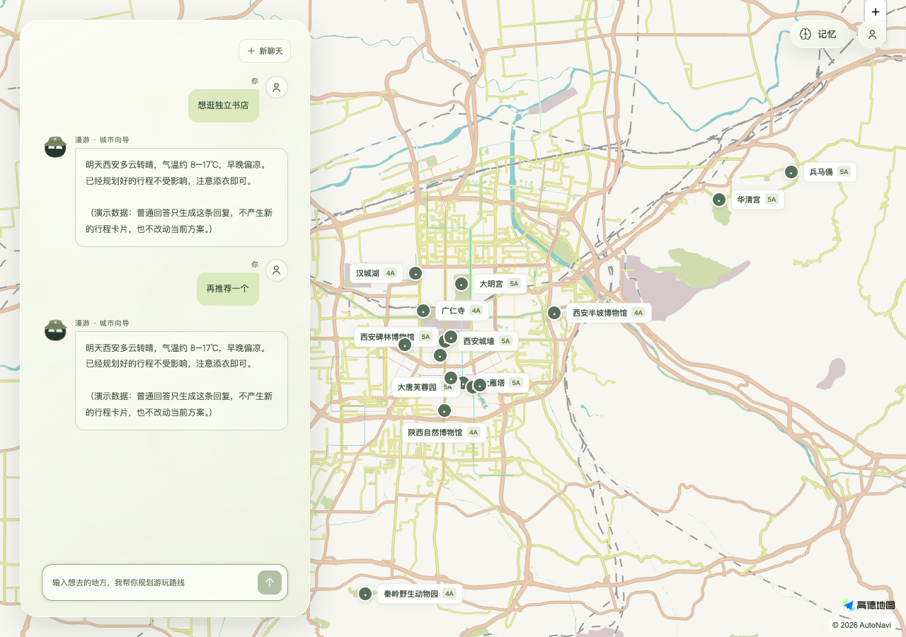
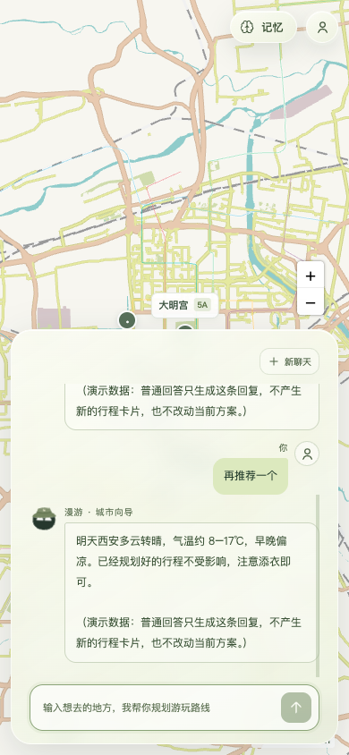
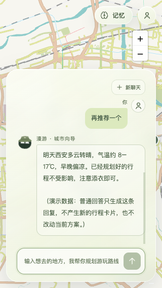

# #62 消息头像验收

助手沿用现有 moss 渔夫帽形象，左上角不再挂载固定人物。普通回答、规划进度、方案卡、追问和错误消息统一经过 `makeMessage()` 挂载头像。仅最新助手消息保留 `boop-face`；上一条转换为 SVG 图片并移除动画实例，触发原组件的帧循环清理。历史恢复全部使用静态头像，新回复重新启用一个动画实例。

用户头像的默认 SVG、姓名字素和渲染逻辑集中在 `frontend/user-avatar.js`。账号状态通过 `setName()` 更新全部 `[data-user-avatar]` 节点，新消息使用同一 renderer。右上角账号按钮、登录登出与无障碍名称保留。

## 验证

- `npm run check`：类型检查及 1023 项测试通过。
- `npm run check:frontend`：全部前端脚本语法检查通过。
- `node docs/issue-62/verify.mjs`：真实 Chrome 在 1280×900、390×844、320×568 下验证双方头像、新头像动画、旧实例断开且 RAF 清零、静态图片可解码、头像来源同步、账号菜单、历史恢复、新聊天及横向溢出。
- 浏览器额外覆盖方案卡、追问、错误、重试与减少动画偏好。单测额外覆盖导入前多消息切换、历史静态化和会话重置。

浏览器使用显式 `?mock=` fixture 对话，没有调用真实 LLM；账号菜单实测开启/关闭，头像同步通过共享模块更新测试，未在浏览器操作真实账号登录。地图正常加载高德 SDK，但本次验收不覆盖真实路线规划与地图分身飞行动画。

重现：先运行 `FRONTEND_PORT=5462 npm run dev:frontend`，再运行 `node docs/issue-62/verify.mjs`；可用 `CHROME` 环境变量指定 Chromium 可执行文件。

## 截图

桌面：

手机：

窄屏：

