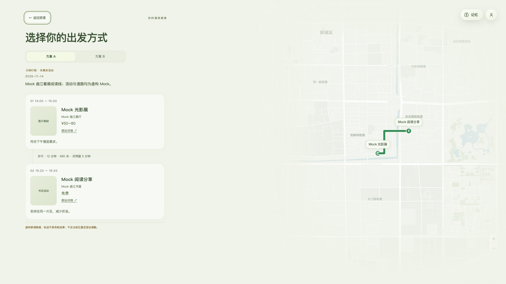
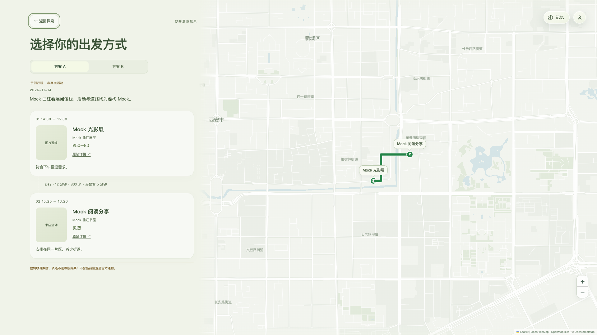
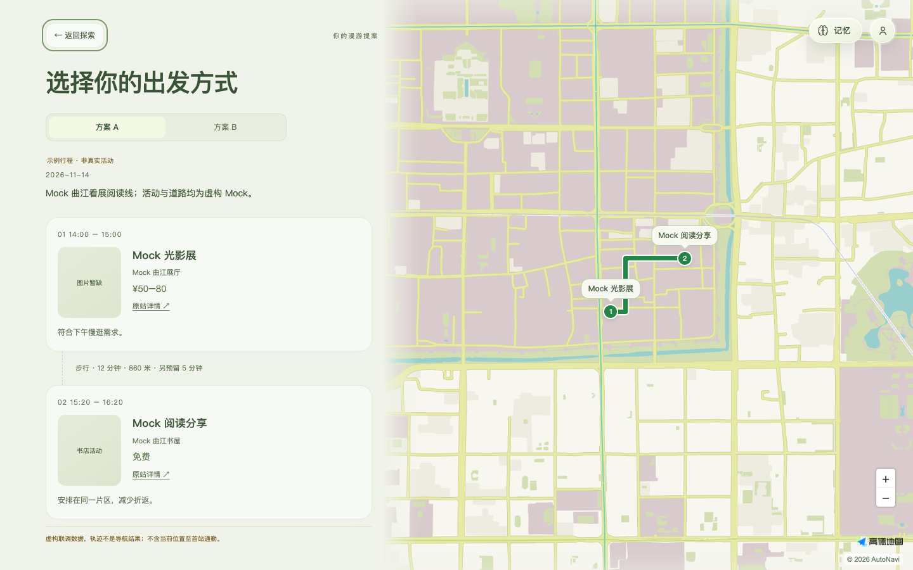

# Issue #66：行程态地图衔接

## 原因和修复

旧地图宽度为 `min(58vw,940px)`，与左侧行程栏独立计算。在 1920px 和 2560px 宽度下，行程卡右缘到地图容器左缘分别留下 356px、964px；按地图宽度计算的 24% 渐隐及多层径向遮罩又放大视觉空白。

桌面行程栏与地图共用 `--itinerary-left`、`--itinerary-width`。地图从行程栏尾部的内部留白处开始，填满剩余宽度；实际卡片与地图间距为 10–16px。桌面左缘渐隐固定为 56px，并取消大范围径向遮罩。两个 provider 共用的取景左边距相应收窄，同时保留站点名称空间。

地图壳、尺寸参考框继续共用 `--focus-map-w`；现有 ResizeObserver、FLIP 动画和路线相机同步机制直接跟随新的目标尺寸。700px 以下保留原有地图布局与遮罩。

## 验证

- 从最新 `origin/main`（`8e16a04`）开始。
- `npm run check`：类型检查、1025 项测试全部通过。
- `npm run check:frontend`、`git diff --check`：通过。
- Chromium 真实 Leaflet/MapLibre：100 项断言通过；真实高德 JS SDK：110 项断言通过。没有替换地图 SDK。
- 尺寸：2560×1080、1920×1080、1440×900、1024×768、823×880、701×800、700×844、390×844、320×568。
- 覆盖地图与目标框一致、无横向溢出、站点在地图内、缩放控件在地图内；A/B 切换、退出恢复全屏、进入中缩放、快速返回再进入、减少动态效果和活动详情面板。
- 700、390、320px 下地图容器几何与 main 基线完全一致。
- 方案使用仓库 mock comparison fixture；Leaflet 路径按既有验收惯例将 fixture 的坐标系标识改为 WGS84，高德保留 GCJ-02。未验证真实 LLM 生成链路。Leaflet 标签本身不接收点击；手机原生站点命中不列入本次断言，站点可见性由几何和截图核查。

| 屏幕宽度 | 修复前实际间距 | 修复后实际间距 |
| --- | ---: | ---: |
| 2560 | 964px | 16px |
| 1920 | 356px | 16px |
| 1440 | 17.61px（另有大范围遮罩） | 16px |
| 1024 | 21.78px（另有大范围遮罩） | 16.02px |
| 823 | 9.55px（另有大范围遮罩） | 10.02px |

## 对比截图

1920×1080 修复前：



1920×1080 修复后（Leaflet）：



1440×900 真实高德：



390×844 移动端：[前](before/focus-390.png) / [后](after/focus-390.png) / [高德](amap/focus-390.png)。

## 复跑

```sh
node docs/issue-66/capture.mjs --out /tmp/issue66-leaflet
node docs/issue-66/capture.mjs --amap --upstream 8080 --out /tmp/issue66-amap
```

第二条需要已有本地开发服务提供高德配置及安全代理；脚本只做同源转发，不保存配置。`--chrome` 指定 Chromium 可执行文件，`--root` 指定前端目录，`--profile before` 跳过修复后的间距阈值。三个目录的 metrics.json 保留完整测量和断言；仓库只保留代表性截图，其余可复跑生成。
