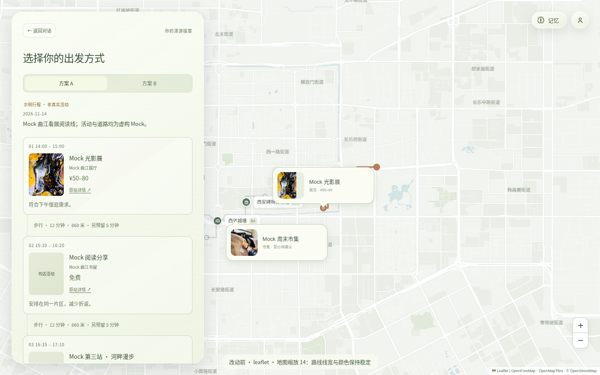
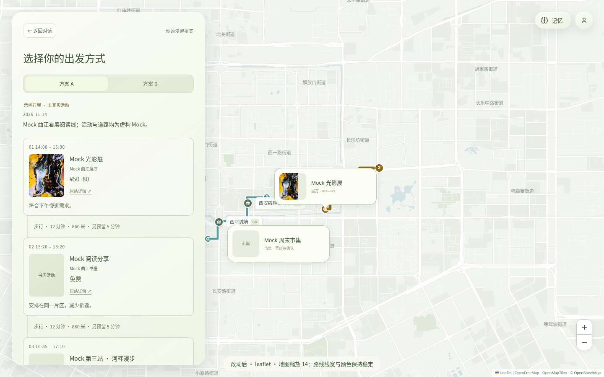

# #18：路线可见性、按站点顺序延展与动态配色

分支 `fix/18-route-visuals` 从最新 `main@c993f38` 创建，只处理 #18。#17 的历史卡片取景修复仍由 PR #30 单独处理，本分支没有混入该改动。

## 呈现规则

- 路线宽度使用屏幕像素，由缩放级别连续计算并限制范围：选中路线 5–8px、未选中路线约 3.5–6px。选中路线增加 2px 浅色描边，未选中路线增加 1.5px 描边。路线圆角，站点编号保持可见；高德和 Leaflet 共用计算。
- 保留完整的淡色轨迹作为底层及取景边界，前景从第一站开始，按行程 stops 顺序沿真实 leg.geometry 逐段延展。相邻段按道路长度分配时间，总时长 1.8–3.6 秒、匀速推进；到达终点后保留完整实线路线，不循环播放。反向几何会按起终站重新定向，缺失道路不补直线、不把分离路段连成假路线。
- 缩放只调整线宽，拖动不重启动画。换方案、清空路线、新聊天、销毁地图都会取消旧动画；图片取色晚于新请求返回时不能把旧路线重新画出来。
- 遵循 `prefers-reduced-motion`：直接显示完整路线；播放中切换到该设置也立即完成并停止动画。

## 配色策略

选择**景点缩略图取色**。地图像素会随拖动改变，且地图画布可能受跨域读取限制，因此不以拖动中的画面作为配色输入。

每个方案最多采样 3 张缩略图，缩到 24×24，统计有色、不透明像素的主要色相。将饱和度归一化、压低明度，保证实色路线相对浅色参考底图 `#edf2e8` 的对比度至少 4.5:1，再用浅色描边分隔道路。两方案色相至少相隔 75°，过近时将后一方案旋转 137.5°，以辨识度优先。

取色等待最多 450ms；缺图、灰白图、跨域/CORS、图片错误或画布读取失败时，以方案 ID 和站点 ID 的哈希生成稳定备用色。配色在路线挂载前确定，并按方案与图片来源缓存（最多 64 组）；图片晚加载、拖动和缩放不会修改正在显示的颜色。

本次示例实际提取 A 为 `#8c6717`、B 经区分调整为 `#137674`；故意破坏缩略图后，备用色为 `#137671` / `#ab1c88`，两种情形均已验证。

## 画面对比与不同缩放级别

真实 OpenFreeMap 街道底图，14 级；同一份三站 Mock 方案：

| 改动前 | 改动后 |
| --- | --- |
|  |  |

| 缩放级别 | 选中实线宽度 | 真实街道背景 | 高德原生叠加层 |
| --- | --- | --- | --- |
| 11 | 5.9px | [截图](leaflet-after-z11.png) | [截图](amap-after-z11.png) |
| 14 | 6.9px | [截图](leaflet-after-z14.png) | [截图](amap-after-z14.png) |
| 16 | 7.6px | [截图](leaflet-after-z16.png) | [截图](amap-after-z16.png) |

[图片取色失败后的备用色截图](amap-after-fallback.png)。

## 录屏与验证

- [Leaflet 改动前](leaflet-before.mp4)
- [Leaflet 改动后：顺序延展、快速切换、缩放、拖动、减少动态效果、取色失败](leaflet-after.mp4)
- [高德改动后：同样交互](amap-after.mp4)
- [浏览器验证摘要](verification.json)

三段 MP4 均已在 Chromium 中完整回放，无解码错误。

2026-11-14 验证：

- `npm run check`：类型检查、864 项测试全部通过。
- `npm run check:frontend`：通过。
- `node --test test/frontend-amap.test.ts test/frontend-plans.test.ts test/frontend-route-visuals.test.ts`：26 项通过。
- 覆盖顺序与折线顶点、反向几何、无假连接、长路线时长上限、旧动画取消、缩放线宽、取色/CORS 失败、对比度、缓存稳定性、减少动态效果，以及异步取色不能恢复已清空路线。
- Chromium 1440×900，真实 Leaflet/OpenFreeMap 和真实高德 JS SDK 2.0。每 50ms 采样前景路径，均记录到“仅第一段推进”与“第一段完成后第二段推进”，没有越序样本；动画结束后保留完整几何。
- 快速 A→B→A 后只有当前方案的两段前景动画；缩放和拖动保持颜色不变。减少动态效果时几何立即完整。故意缺图时两个方案都使用不同的稳定备用色。浏览器无未捕获 JS 异常。

取景仍使用整条静态轨迹和所有站点，不使用动画当前端点，避免播放时相机跟着线头移动。

### 测试边界

使用 [route-demo.json](route-demo.json)，由仓库 Day 0 样例扩为每个方案 3 站，图片使用仓库本地示意配图；聊天接口返回这一固定样本，没有调用真实 agent。所有地点与道路均为虚构，不能作为导航结果。高德样本标记为 GCJ-02，Leaflet 使用同形的 WGS84 模拟样本，仅验证两种呈现器，不作坐标转换正确性的证明。

高德矢量底图在该环境返回 403（`FlyDataAuthTask error: param version not valid`），其截图仅证明原生路线叠加层、投影与交互。复杂道路背景的可读性由真实 OpenFreeMap 街道截图和录屏验证；本 PR 没有修改高德鉴权或底图加载。
